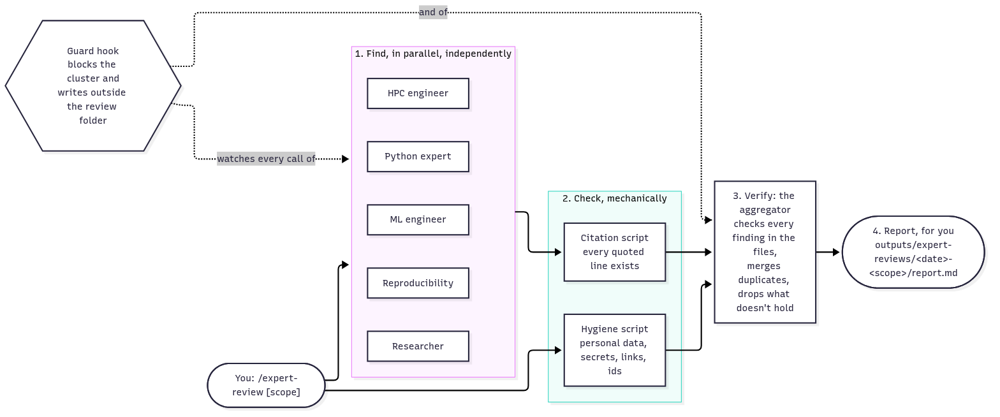

# .claude

Claude Code configuration for this repository: skills, subagents and hooks. The agents' rules are in the root [CLAUDE.md](../CLAUDE.md).

## Skills

Invoked with `/<name>`.

| Skill | What it does | Invocation |
|---|---|---|
| [commit-plan](skills/commit-plan/SKILL.md) | Checks the uncommitted changes and proposes Conventional Commits, with the git commands for you to run | when you ask for a commit plan |
| [expert-review](skills/expert-review/SKILL.md) | A panel of independent expert reviewers (Python, ML engineering, HPC/Slurm, reproducibility, research) reviews a scope; an aggregator verifies and merges their findings into one report in `outputs/expert-reviews/` | manual only: `/expert-review [scope]` |

## Subagents

| Agent | Used by | Why it exists |
|---|---|---|
| [expert-reviewer](agents/expert-reviewer.md) | `expert-review` | one reviewer, with limited tools and the guard hook |
| [expert-review-aggregator](agents/expert-review-aggregator.md) | `expert-review` | verifies and merges the findings and returns the report as text (subagents can't write report files), with the same limits |

## Hooks

| Hook | Runs | What it does |
|---|---|---|
| [expert_review_guard.py](hooks/expert_review_guard.py) | before every shell command and Write/Edit call, registered in [settings.json](settings.json); it acts only when the caller is one of the two subagents above | blocks running a cluster or network program (`ssh`, `rsync`, Slurm) or a cluster script, `run_local.sh` or `render_diagrams.sh` (they write files) under any path; blocks Write/Edit outside `outputs/expert-reviews/`. Reading or checking the scripts stays allowed |

**Why in `settings.json`:** a hook declared inside a subagent's own definition silently didn't run in the first review (2026-11-01). A project hook always runs, and the hook input names the calling agent (`agent_type`), so the guard applies only to the reviewers and leaves your main session alone.

**Audit log:** every call the guard checks for those subagents is logged, allowed or blocked, one line each, in `outputs/expert-reviews/guard.log` (git-ignored). It shows what the review agents did, and proves the guard runs: verified live on 2026-11-01 without restarting Claude Code.

The guard inspects command text: it catches mistakes, but it is not a security boundary. The agents' instructions forbid the same things. Its behavior is tested in `tests/test_expert_review_guard.py`.

## The expert review's scripts

Mechanical steps of the skill, run by the orchestrating session, never by the review agents:

| Script (`skills/expert-review/scripts/`) | What it does | Why |
|---|---|---|
| [check_hygiene.py](skills/expert-review/scripts/check_hygiene.py) | Checks every file git would commit for personal data (`PRIVATE_PATTERNS` in `.env`; not applied to bibliographic content, where authors' names belong), secrets, broken links, unknown ids, and UK spellings | Things with right or wrong answers are checked by a script, not by opinion |
| [check_citations.py](skills/expert-review/scripts/check_citations.py) | Checks that each finding's file, line and quoted text exist | Reviewers' findings are verified against the files before anyone trusts them |
| [save_report.py](skills/expert-review/scripts/save_report.py) | Saves the aggregator's report, returned as text, to `report.md` | Subagents can't write report files themselves |

## The expert review in short



*Source: [../docs/project/diagrams/expert-review.mmd](../docs/project/diagrams/expert-review.mmd)*

```
/expert-review [project | all | <path>] [--roles python-expert,hpc-engineer,…] [--max-findings 15]
```

1. A hygiene script checks the repository mechanically: personal data, secrets, links, ids, US English.
2. One reviewer per role reads the scope independently and writes its findings, each with a quoted location.
3. A script checks every citation against the files.
4. An aggregator verifies each finding, merges duplicates, re-rates severity and returns the report; a script saves it as `report.md`.

- **Output:** `outputs/expert-reviews/<date>-<scope>/` (git-ignored): `run.md`, `checks/`, `roles/`, `report.md`.
- **Never touches the cluster:** checks that need it are listed in the report as *proposed checks*, for you to approve and run.
- **Roles:** five now (`python-expert`, `ml-engineer`, `hpc-engineer`, `reproducibility`, `researcher`); three more (`methodology`, `timeseries`, `merging`) when their material exists. See [references/roles.md](skills/expert-review/references/roles.md).
- **Personal-data check:** set `PRIVATE_PATTERNS` in your `.env` (a regular expression of names and identifiers that must never appear in committed files); without it, only generic patterns are checked.
