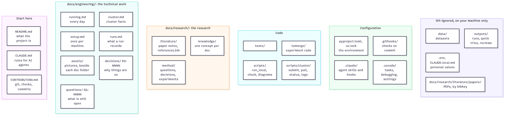

# Docs

Everything we write lives here. External sources (papers) are kept apart and never edited.

## Knowledge first

Every experiment answers a question, every result supports or refutes a claim, and every lasting choice has a decision. Each has a stable, grep-able id: never changed, never reused, even after its file is deleted. Ids are unique per area and type: engineering questions (`EQ-`), engineering decisions (`ED-`), research questions (`RQ-`), research decisions (`RD-`) and experiments (`e`) each count on their own.

| Type | Id |
|---|---|
| Question | `EQ-NNNN` (engineering), `RQ-NNNN` (research) |
| Decision | `ED-NNNN` (engineering), `RD-NNNN` (research) |
| Experiment | `eNNNN-<slug>`, e.g. `e0001-joint-vs-merge` ([ED-0032](engineering/decisions/ED-0032-experiment-ids.md)) |
| Claim | to be defined, with the method docs |
| Paper | bibkey |

Knowledge flows one way: sources → literature notes → concepts → questions → experiments → results → claims → thesis. Later layers link to earlier ones and never restate them.

## Contents

*Source: [assets/repository-map.mmd](assets/repository-map.mmd)*

- [engineering/](engineering/README.md): all the technical work around the research: setup, the environment, the Unimore cluster, running and recording runs, checks and tooling, with its decisions (`ED-`) and open questions (`EQ-`).
- [research/](research/README.md): the research itself: [literature/](research/literature/README.md) (what others published: paper notes and the bibliography), [knowledge/](research/knowledge/README.md) (general theory, one concept per doc) and [method/](research/method/README.md) (everything specific to this work: protocol, experiments, findings), with its [decisions](research/decisions/README.md) (`RD-`) and [questions](research/questions/README.md) (`RQ-`).

## Assets

Pictures live **beside the docs that show them**, never in one central folder:

- each doc folder with pictures has an **`assets/`** subfolder, e.g. `docs/engineering/assets/`, `docs/research/knowledge/signals/assets/`;
- a picture shown by docs in several folders goes in the `assets/` of their nearest common folder (e.g. `docs/assets/` for one shown in `docs/README.md` and `docs/engineering/overview.md`);
- an `assets/` folder holds the pictures **and what generates them** (a Mermaid `.mmd` source, a drawing script), and a short README listing each file, what it shows and where it's shown;
- **the tool follows what the picture shows,** wherever it lives: a Mermaid `.mmd` source for structure and process (boxes, arrows, states, steps), a Python drawing script for data and functions (axes, curves, numbers).

How diagrams are made and checked: [engineering/assets/README.md](engineering/assets/README.md).
