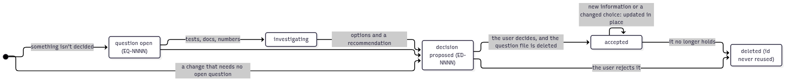

# Engineering decisions

Technical and organizational decisions: how the repository, the environment and the compute setup work.

Research decisions (methods, datasets, metrics, and how the research docs work) belong to the research area: [docs/research/decisions/](../../research/decisions/README.md), with `RD-` ids.

**Decisions are history and rationale, not the documentation.** How things work is always described in the engineering docs ([setup](../setup.md), [cluster](../cluster.md), [running](../running.md), [runs](../runs.md), [CONTRIBUTING](../../../CONTRIBUTING.md), the folder READMEs), which link to the decisions for the *why*. A decision never holds the only copy of an operational fact.

**Why every relevant decision is written down:** without it, nobody can later reconstruct why something is the way it is, and nobody can tell whether a choice still holds. Each record states the problem it solves and when it should be reconsidered, so it can be checked, and if needed overturned, on its own reasons. Only truly minor choices (a wording, a variable name) go without a record.

## Rules



*Source: [../assets/questions-and-decisions.mmd](../assets/questions-and-decisions.mmd)*

- **One file per decision:** `ED-NNNN-short-slug.md`, e.g. `ED-0001-python-and-pytorch.md`.
- **Stable ids:**
  - an id and its file name never change;
  - an id is never reused, not even for a deleted decision; engineering decisions have their own counter, separate from questions and from research decisions;
  - only a typo in a title may be fixed;
  - the next id is the **highest id used** (recorded below the index) plus one.
- **Statuses:** `proposed` → `accepted`. Only the user accepts a decision; a rejected proposal is deleted.
- **Decisions describe the present.** Every decision states a choice that holds now, and why; the repository's past (old paths, names, ids) lives only in git history.
- **Decisions are not frozen.** When new information emerges (a test result, a cluster rule, a consequence), update the decision in place, even after it is accepted and committed.
- **When the choice itself changes,** update the decision so it states the new choice; it may say briefly what changed and why, under **Changes**, one dated line each. Moves, renames and rewordings are never logged: a decision is not a changelog.
- **A decision that no longer holds** is deleted, and a new decision is written if a new choice replaces it. Its id is never reused.
- **A reorganization is not a decision:** moving or renaming files, folders or ids changes the docs that describe them, and the commit message says why.
- **Docs follow decisions.** When a decision is accepted, updated or deleted, in the same step:
  - update every Markdown file it affects, and every diagram ([diagrams](../assets/README.md));
  - close the [questions](../questions/README.md) it answers: their content moves into the decision, and the question files are deleted.
- **Short and readable:** about one screen, one idea per line, lists as bullets. Link to details instead of restating them.

## Template

```markdown
# ED-NNNN — <the choice, stated as what we do>

- **Status:** proposed | accepted
- **Date:** YYYY-MM-DD
- **Decided by:** the author
- **Answers:** question EQ-NNNN (opened YYYY-MM-DD, …), if the decision closes one
- **Changes:** (only if the choice itself changed) one dated line per change: what changed, and why

## Problem

What went wrong or was missing, why it mattered, the constraints; where it came from
(a review, a failed run, a question).

## Options

### A — …

- what it gives;
- what it costs.

### B — …

- what it gives;
- what it costs.

## Decision

What we chose, and why. How it was verified, if it was.

## Consequences

- what changes;
- what gets harder;
- related small fixes;
- follow-ups (EQ-NNNN).

## Revisit if

- the conditions under which this decision should be reconsidered.
```

## Index

| Id | Decision | Status | Date |
|---|---|---|---|
| [ED-0001](ED-0001-python-and-pytorch.md) | Python 3.12.16 and PyTorch 2.14.1 with CUDA 12.6, managed by uv everywhere | accepted | 2026-11-01 |
| [ED-0002](ED-0002-cluster-partition.md) | Cluster partitions: `all_usr_prod` for GPU work, `all_serial` for light work, never `boost_usr_prod` | accepted | 2026-11-01 |
| [ED-0003](ED-0003-runs-and-jobs.md) | Experiments, runs and jobs: one run per job, one folder per run | accepted | 2026-11-01 |
| [ED-0004](ED-0004-gpu-allow-list.md) | GPU models: a committed allow-list, checked at submit time and in the job | accepted | 2026-11-01 |
| [ED-0005](ED-0005-uv-cache-on-the-cluster.md) | On the cluster, uv's cache is temporary, on the login node's local disk | accepted | 2026-11-01 |
| [ED-0006](ED-0006-run-endings.md) | Every run records how it ended | accepted | 2026-11-01 |
| [ED-0007](ED-0007-run-provenance.md) | Runs carry their own provenance: commit plus a complete patch | accepted | 2026-11-01 |
| [ED-0008](ED-0008-environment-integrity.md) | Runs can't use a mismatched environment | accepted | 2026-11-02 |
| [ED-0009](ED-0009-run-records.md) | What every run records: `run.json` and `config.json` | accepted | 2026-11-01 |
| [ED-0010](ED-0010-safe-submissions.md) | Submissions fail cleanly and never overwrite a run | accepted | 2026-11-02 |
| [ED-0011](ED-0011-expert-review-guard.md) | Expert reviews: a guard keeps the review agents off the cluster | accepted | 2026-11-01 |
| [ED-0012](ED-0012-code-checks.md) | Code checks: one script, explicit rules, run on every commit | accepted | 2026-11-02 |
| [ED-0013](ED-0013-default-job-resources.md) | Default job resources, all set in one committed file | accepted | 2026-11-02 |
| [ED-0014](ED-0014-personal-values.md) | Personal values in a git-ignored `.env`, project settings committed | accepted | 2026-11-01 |
| [ED-0015](ED-0015-session-unlock.md) | One session step unlocks SSH keys and the cluster | accepted | 2026-11-01 |
| [ED-0016](ED-0016-engineering-docs.md) | Engineering docs split by concern; questions end as decisions or docs | accepted | 2026-11-02 |
| [ED-0017](ED-0017-git-by-people.md) | People run git; AI agents propose commits | accepted | 2026-11-01 |
| [ED-0018](ED-0018-self-contained-repository.md) | A self-contained repository: no local paths or personal values, no references to the material used to build it | accepted | 2026-11-01 |
| [ED-0019](ED-0019-expert-reviews.md) | In-depth reviews by a panel of independent expert agents | accepted | 2026-11-01 |
| [ED-0020](ED-0020-dataset-location.md) | Datasets live in a data folder outside the code: `data/` locally, the work area on the cluster | accepted | 2026-11-02 |
| [ED-0021](ED-0021-runs-and-their-inputs.md) | Runs don't resume; a run names the earlier runs it reads | accepted | 2026-11-02 |
| [ED-0022](ED-0022-cpu-jobs.md) | CPU-only jobs go through `submit.sh` too, on `all_serial` by default | accepted | 2026-11-02 |
| [ED-0023](ED-0023-durations-and-budget.md) | Watch run durations and estimated cost from the run records | accepted | 2026-11-02 |
| [ED-0024](ED-0024-large-transfers.md) | Large transfers go through the login node, as resumable copies | accepted | 2026-11-02 |
| [ED-0025](ED-0025-run-safety.md) | Runs keep their provenance and results safe: pushed commits, no requeue, local backup | accepted | 2026-11-02 |
| [ED-0026](ED-0026-results-format.md) | Every run writes its metrics to `results/metrics.json`, in one fixed format | accepted | 2026-11-02 |
| [ED-0027](ED-0027-gpu-pool.md) | Runs may use every allowed GPU; numerics are made explicit, not left to the hardware | accepted | 2026-11-02 |
| [ED-0028](ED-0028-diagrams.md) | Diagrams: Mermaid sources, committed PNG images, rendered with Docker | accepted | 2026-11-02 |
| [ED-0029](ED-0029-local-runs.md) | Local runs are recorded like cluster runs, from a frozen copy of the code | accepted | 2026-11-02 |
| [ED-0030](ED-0030-experiment-code.md) | Experiment code in a `tsmerge/` package, run as modules, not installed; a shared run helper | accepted | 2026-11-02 |
| [ED-0031](ED-0031-vs-code.md) | Shared VS Code tasks, debug configurations, extensions and settings | accepted | 2026-11-02 |
| [ED-0032](ED-0032-experiment-ids.md) | Experiments are named `e<NNNN>-<slug>`, and each has a short doc | accepted | 2026-11-02 |
| [ED-0033](ED-0033-training-curves.md) | Training curves go in the run folder (`results/history.jsonl`); no wandb for now | accepted | 2026-11-02 |

**Highest id used:** ED-0037. The next decision takes the number after it, even if decisions with lower numbers have been deleted.
