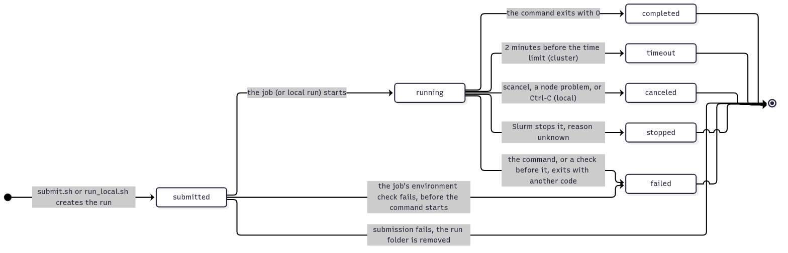

# Runs

What a run is, where it lives and what it records. How to launch and follow runs is in [running.md](running.md). The reasons behind each choice are in the linked decisions.

## Concepts

- **Experiment:** a named study that groups runs. Its name is `e<NNN>-<slug>`, e.g. `e001-joint-vs-merge`: the id never changes and is never reused, and a short doc in the research area ([method/](../research/method/README.md)) says which research questions it answers ([ED-032](decisions/ED-032-experiment-ids.md)). Setup and smoke-test runs use plain names such as `hello`. Every name: lowercase letters, digits, `-`, `_`.
- **Run:** one execution of one configuration, one seed included.
- **Job:** one Slurm submission. One job runs exactly one run.
- **Recorded run:** a run started by `scripts/run_local.sh` (locally) or `scripts/cluster/submit.sh` (on the cluster): it gets a run folder and the records below. A script started directly (`python -m …`, or the debugger) is not a recorded run: its outputs go to `outputs/scratch/`, overwritten each time ([ED-029](decisions/ED-029-local-runs.md)).
- **Sweep:** a set of runs, each still one job, grouped by a sweep id given at submit time (`SWEEP=<id>`).

Why one run per job: [ED-003](decisions/ED-003-runs-and-jobs.md).

## Run id

`<YYYYMMDD-HHMMSS>-<4 hex>`, e.g. `20261102-141503-a3f9`.

- Generated on your machine when the run is launched, never from the Slurm job id.
- The same id names the run folder and, for cluster runs, its line in `outputs/jobs.log`.
- A run folder is never reused: a submission fails if the folder already exists ([ED-010](decisions/ED-010-safe-submissions.md)).

## Run folder

The same layout locally and on the cluster:

```
<runs root>/<experiment>/<run id>/
├─ run.json      how the run was launched and how it went
├─ config.json   what the run computed with
├─ code/         frozen copy of the code the run executes (kept on the cluster, not pulled;
│                deleted at the end of local runs)
├─ provenance/   uncommitted changes at launch: patch.diff, git-status.txt
├─ output.log    everything the command printed
├─ results/      metrics.json, history.jsonl, other small result files (json, csv)
├─ checkpoints/  model weights (pulled only on request)
└─ wandb/        reserved for wandb's local files, if wandb is added
```

| Where | Path |
|---|---|
| Local runs root | `outputs/runs/` (git-ignored) |
| Cluster runs root | `/work/<project account>/<username>/tsmerge/runs/` |
| Cluster code mirror (the latest submitted code, for remote debugging) | `/homes/<username>/tsmerge/code/` |
| Cluster environment | `/homes/<username>/tsmerge/venv/` |
| Cluster per-job temporary files | `/work/<project account>/<username>/tsmerge/tmp/<job id>/`, deleted at job end |

- `run_local.sh` writes local runs into `outputs/runs/` directly.
- `pull.sh` copies cluster runs into `outputs/runs/` with the same paths, without `code/`, and without `checkpoints/` unless asked.
- Either way, the folders look alike; `run.json`'s `launcher` says where a run ran. Runs launched before 2026-11-02 have `slurm.out` instead of `output.log`.

## What a run provides

Every recorded run gets these environment variables. The experiment code reads them through `tsmerge/run.py`, which falls back to the defaults in the last column when a script is started directly.

| Variable | What it is | Cluster run | Local run (`run_local.sh`) | Started directly |
|---|---|---|---|---|
| `RUN_DIR` | this run's folder: write `results/` and `checkpoints/` here | the run folder | the run folder | `outputs/scratch/` |
| `DATA_DIR` | the datasets folder ([ED-020](decisions/ED-020-dataset-location.md)) | `/work/<project account>/<username>/tsmerge/data/` | `DATA_DIR` in `.env`, or `data/` in the repository | `DATA_DIR` if set (the debugger loads `.env`; in a terminal, `uv run --env-file .env`), or `data/` |
| `RUNS_ROOT` | the root of all runs, to read the outputs of the runs listed in `inputs` ([ED-021](decisions/ED-021-runs-and-their-inputs.md)) | `/work/<project account>/<username>/tsmerge/runs/` | `outputs/runs/` | `outputs/runs/` |
| `TMPDIR` | a temporary folder, deleted at the end of the job | `/work/…/tsmerge/tmp/<job id>/` | the system's | the system's |
| `SLURM_CPUS_PER_TASK` | the CPU cores the job has, e.g. for data-loader workers | 6 by default | — | — |

## `run.json`: how the run was launched and how it went

Written by `submit.sh` or `run_local.sh`, completed when the run starts and ends ([ED-009](decisions/ED-009-run-records.md)):

| Group | Fields |
|---|---|
| Identity | `run_id`, `experiment`, `launcher` (`cluster` or `local`), `sweep`, `inputs` (the earlier runs it reads), `command` |
| Code and environment | `git_commit`, `git_dirty`, `uv_lock_sha256`, `uv_version` |
| Slurm options actually used (`slurm`; `null` for local runs) | `profile` (`gpu` or `cpu`), `account`, `partition`, `constraint`, `nodes`, `ntasks`, `cpus_per_task`, `gpus`, `time`, `signal`, `requeue`, `extra_options` |
| Where it ran | `host`, `slurm_job_id` (`null` locally), `gpus`, `gpu_capability`, `driver`, `python`, `torch`, `torch_cuda`, `cudnn` |
| How it went | `submitted_at`, `started_at`, `ended_at`, `exit_code`, `status` |

### How a run ended: `status`



*Source: [assets/run-statuses.mmd](assets/run-statuses.mmd)*

| Status | Meaning |
|---|---|
| `submitted` | launched, not started yet (on the cluster: waiting in the queue) |
| `running` | started, still running (or the node died without warning) |
| `completed` | the command exited with 0 |
| `failed` | the command, or a check before it, exited with another code: see `output.log` |
| `timeout` | stopped at the time limit: rerun with a larger `CLUSTER_TIME` |
| `canceled` | stopped before its time limit (`scancel`, a node problem, or Ctrl-C in a local run) |
| `stopped` | stopped by Slurm, but the reason couldn't be determined |

- Slurm warns the job **2 minutes before** its time limit, so the job script can record the ending and stop the command cleanly. A run therefore gets its time limit **minus 2 minutes**.
- Slurm's own record (`sacct`, `status.sh <job id>`) shows such runs as `FAILED` with exit code 15, not `TIMEOUT`: trust `run.json`.
- The program needs nothing special for this.
- **Runs don't resume:** a run that times out is resubmitted from scratch, with a larger `CLUSTER_TIME` ([ED-021](decisions/ED-021-runs-and-their-inputs.md)).

Why it works this way: [ED-006](decisions/ED-006-run-endings.md).

## `config.json`: what the run computed with

Written by the experiment code when the run starts, before any computation, locally and on the cluster alike ([ED-009](decisions/ED-009-run-records.md)):

| Field | Contents |
|---|---|
| `config` | every setting with its final value, **defaults included**, not only what was typed |
| `seeds` | a training seed, and a separate evaluation seed (default: training seed + 1) |
| `data` | for each dataset: name, source or version, a checksum of the files used, the split definition |
| `determinism` | `cudnn_deterministic`, `cudnn_benchmark`, `allow_tf32_matmul`, `allow_tf32_cudnn`, `use_deterministic_algorithms`: the PyTorch settings `run.set_numerics()` applies (TF32 off by default) |

Results are compared by reading these files, never by parsing commands or folder names. The experiment code writes it with `run.write_config()` ([tsmerge/run.py](../../tsmerge/run.py)); `tsmerge/hello.py` shows how.

## `results/metrics.json`: what the run measured

Every run writes its metric values in one fixed format ([ED-026](decisions/ED-026-results-format.md)), with `run.write_metrics()`, which refuses records outside the format: a list of records, one per value.

```json
[
  {"phase": "merged", "split": "test", "metric": "mse", "value": 0.412},
  {"phase": "finetune_0", "split": "val", "metric": "mse", "value": 0.388}
]
```

| Field | Meaning |
|---|---|
| `phase` | which model the value belongs to, when a run produces several (base, fine-tuned, merged); omitted when there is one |
| `split` | `train`, `val` or `test` |
| `metric` | the metric's name |
| `value` | a number |

One aggregation script, written with the first experiment, joins `run.json`, `config.json` and `metrics.json` into one table per sweep or experiment; thesis tables and figures come from those tables.

## `results/history.jsonl`: curves during the run

Values logged during training, one JSON line per value, appended as the run goes ([ED-033](decisions/ED-033-training-curves.md)):

```json
{"step": 50, "split": "train", "metric": "loss", "value": 0.0102}
{"step": 100, "epoch": 1, "split": "val", "metric": "loss", "value": 0.0096}
```

- The fields of `metrics.json`, plus `step` and, optionally, `epoch`.
- Written with `run.log_history()`; each line is written at once, so a run that stops keeps every point logged before it stopped.
- `metrics.json` holds the final values; `history.jsonl` holds how they got there.

## Provenance: the exact code of a run

- `git_commit` names the commit; `provenance/patch.diff` holds every uncommitted difference at launch, **new files included**, binary-safe.
- A run launched from a clean tree is exactly its commit; `submit.sh` warns when it isn't, `run_local.sh` notes it.
- To rebuild a run's code: [running.md](running.md#rebuilding-a-runs-code).

Why: [ED-007](decisions/ED-007-run-provenance.md).
