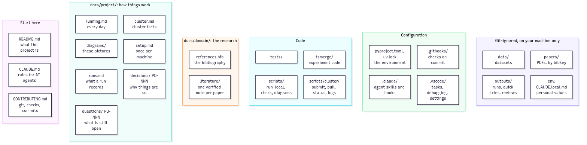
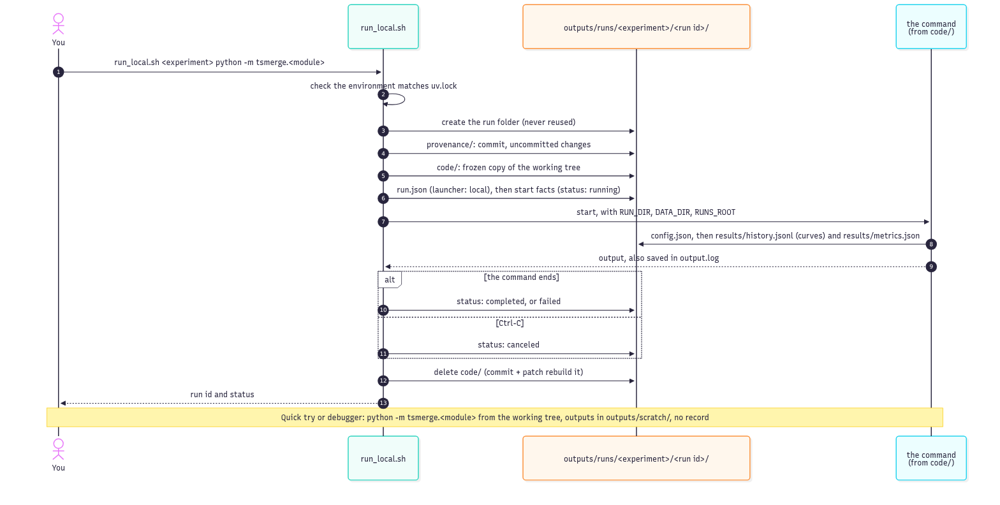
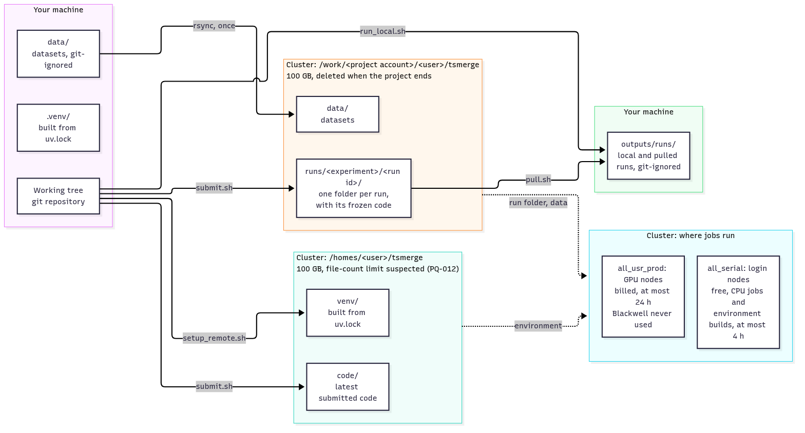
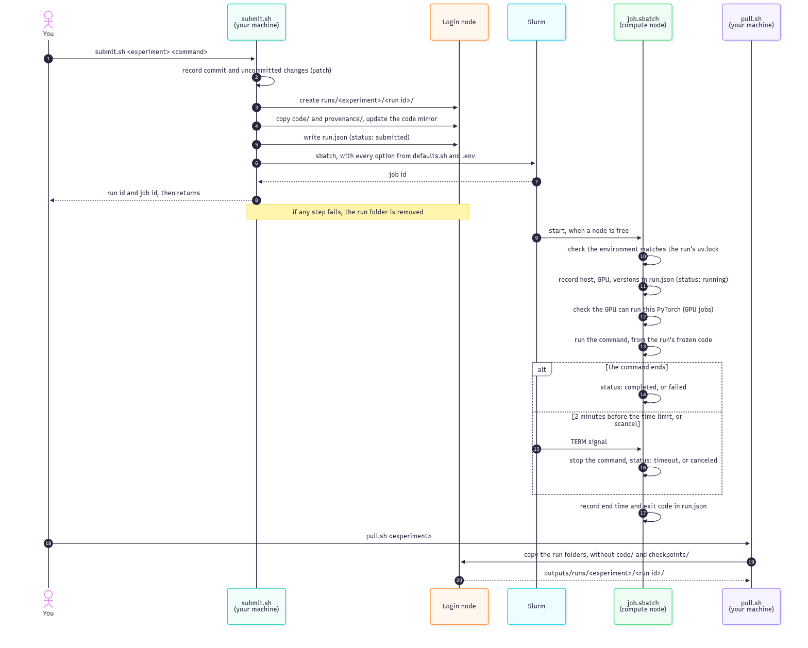
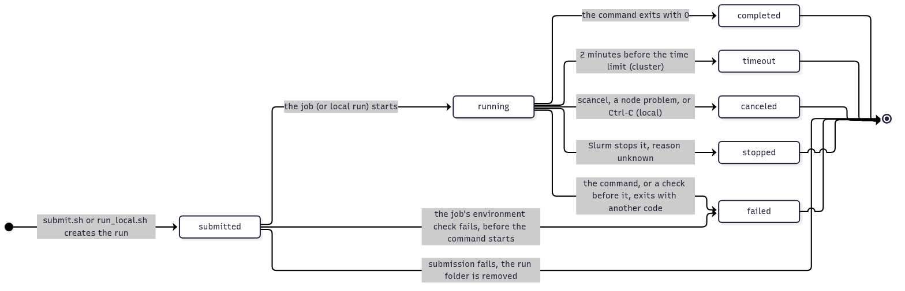
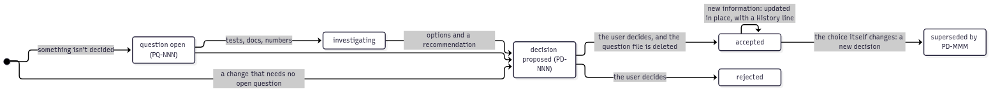

# How the repository works: a guided tour

What this repository's machinery does, why each piece exists, and where to read more. Read it top to bottom once; afterwards, the [inventory](#every-file-in-the-repository) at the end says what any file is for.

- **This page is a map, not the reference:** each part links to the doc that holds the details, and to the decision (`PD-NNN`) that explains why.
- Nothing here is about the research itself: that lives in the domain area, still to be written.

*Source: [diagrams/repository-map.mmd](diagrams/repository-map.mmd)*

## 1. The idea: your machine is the source of truth

- You write code, commit and keep results **on your machine**. The Unimore cluster only computes.
- Every run, local or on the cluster, gets **its own folder with a full record**: what code ran (commit plus uncommitted changes), with which settings, on which machine, and how it ended.
- Every choice that shapes the setup is a **decision** with its reasons; every fact you need day to day is in a **doc**.

Why: results must be traceable months later, by you and by examiners; cluster storage isn't backed up and disappears when the account ends ([PD-003](decisions/PD-003-runs-and-jobs.md), [PD-025](decisions/PD-025-run-safety.md)).

## 2. The environment: the same Python everywhere

| Piece | What it does | Why |
|---|---|---|
| **uv** | Installs Python and every package, locally and on the cluster | One tool, one lockfile: identical environments on every machine ([PD-001](decisions/PD-001-python-and-pytorch.md)) |
| `pyproject.toml` | Lists the dependencies (PyTorch 2.14.1 for CUDA 12.6, numpy; pytest and ruff for development) and the tools' settings | The single place where dependencies are chosen |
| `uv.lock` | Pins the exact version of every package | Reproducibility: the same lockfile gives the same environment |
| `.python-version` | Pins Python 3.12.16 | Not just "3.12": every machine runs the identical build |

- Locally the environment is `.venv/` (`uv sync`); on the cluster it's built by `setup_remote.sh` ([section 4](#4-running-on-the-cluster)).
- **Why CUDA 12.6:** the newest PyTorch build the cluster's drivers (535) support; it covers 72 of the cluster's 87 GPUs. Blackwell GPUs can't run it, so they're always excluded ([PD-001](decisions/PD-001-python-and-pytorch.md), [PD-004](decisions/PD-004-gpu-allow-list.md)).

Reference: [setup.md](setup.md#4-python-with-uv).

## 3. The experiment code and local runs

| Piece | What it does | Why |
|---|---|---|
| [`tsmerge/`](../../tsmerge/README.md) | The experiment code, run as `python -m tsmerge.<module>`, **not installed** | Each run imports exactly its own frozen copy of the code ([PD-030](decisions/PD-030-experiment-code.md)) |
| `tsmerge/run.py` | The helper every experiment uses: folders, device, seeds, numeric settings, and the records (`config.json`, `metrics.json`, `history.jsonl`) | Every experiment writes the same records, in the same formats ([PD-009](decisions/PD-009-run-records.md), [PD-026](decisions/PD-026-results-format.md), [PD-033](decisions/PD-033-training-curves.md)) |
| `tsmerge/hello.py` | The smallest complete experiment: fits a linear model, with every step a real one takes | The template for new experiments, and the smoke test of a new setup |
| `scripts/run_local.sh` | Runs a command as a **recorded local run**: run folder in `outputs/runs/`, `run.json`, provenance, `output.log`, end status | Local results are as traceable as cluster ones ([PD-029](decisions/PD-029-local-runs.md)) |

- A recorded local run executes from a **frozen copy** of the code, deleted at the end, so you can keep editing while it runs.
- A quick try (`uv run python -m tsmerge.<module>`) or a debugger session isn't recorded: its outputs go to `outputs/scratch/`.

Reference: [running.md](running.md#running-locally).

## 4. Running on the cluster

| Script (`scripts/cluster/`) | What it does | Why |
|---|---|---|
| `setup_remote.sh` | Builds the cluster's environment from `uv.lock`, as a Slurm step on the free `all_serial` partition | The same environment as yours; never heavy work on the shared login node ([PD-008](decisions/PD-008-environment-integrity.md)) |
| `submit.sh` | Creates the run folder, freezes the code, records provenance, writes `run.json`, submits the job | One command per run, every Slurm option preset ([PD-010](decisions/PD-010-safe-submissions.md), [PD-013](decisions/PD-013-default-job-resources.md)) |
| `job.sbatch` | The generic job: checks the environment and the GPU, runs the command, **always records how it ended** | A run's status is reliable even on time-outs and cancels ([PD-006](decisions/PD-006-run-endings.md)) |
| `status.sh`, `logs.sh` | Your queue or one job's state; the end of a job's output | Follow jobs without remembering Slurm commands |
| `pull.sh` | Copies runs back into `outputs/runs/`, without code and (unless asked) checkpoints | Cluster storage isn't backed up ([PD-025](decisions/PD-025-run-safety.md)) |
| `defaults.sh` | Every Slurm setting: partition, allowed GPU models, CPUs, time limit | Settings are decisions, so they're committed in one place ([PD-002](decisions/PD-002-cluster-partition.md), [PD-027](decisions/PD-027-gpu-pool.md)) |
| `common.sh` | Shared helpers: loads `.env`, checks the connection, copies code, builds the provenance patch | Written once, used by every script |
| `run_info.py` | Adds where and how a run ran (host, GPU, versions, start, end, status) to `run.json` | Used by cluster jobs and local runs alike |
| `check_gpu.py` | Stops a job at once on a GPU this PyTorch can't use | A clear error instead of a cryptic one ([PD-004](decisions/PD-004-gpu-allow-list.md)) |

- **Before using the cluster each session:** `scripts/start-session.sh` unlocks your SSH keys and opens one shared connection, so scripts never ask for passwords ([PD-015](decisions/PD-015-session-unlock.md)).
- **Personal values** (account, paths, keys) live in the git-ignored `.env`; its template is `.env.example` ([PD-014](decisions/PD-014-personal-values.md)).
- **Lessons the cluster taught us** are in [cluster.md](cluster.md#observed-behavior): the file limit suspected on `/homes`, the 24 GB rule, no requeueing, the unreachable data node.

Reference: [running.md](running.md#running-on-the-cluster), [scripts/cluster/README.md](../../scripts/cluster/README.md).

## 5. What a run records

Every run folder, local or cluster, holds the same files ([runs.md](runs.md)):

| File | Written by | Holds |
|---|---|---|
| `run.json` | the launcher and the job | what ran, where, with which Slurm options, how it ended |
| `config.json` | the experiment code | every setting, seeds, datasets, numeric settings |
| `results/metrics.json` | the experiment code | the final values, one record each |
| `results/history.jsonl` | the experiment code | the curves, one line per value during training |
| `provenance/` | the launcher | uncommitted changes, so the exact code can be rebuilt |
| `output.log` | the launcher | everything the command printed |

Experiments are named `e<NNN>-<slug>`, e.g. `e001-joint-vs-merge` ([PD-032](decisions/PD-032-experiment-ids.md)).

## 6. Quality gates: what keeps the repository clean

| Piece | What it does | Why |
|---|---|---|
| `scripts/check.sh` | Runs every check: lockfile, ruff lint and format, shellcheck, the tests, the diagrams | One list of checks, used by people, hooks and agents ([PD-012](decisions/PD-012-code-checks.md)) |
| `.githooks/pre-commit` | Runs `check.sh` on every commit | No commit skips the checks |
| `.githooks/commit-msg` | Rejects messages that aren't Conventional Commits | A readable history |
| `.shellcheckrc` | ShellCheck's options, shared by `check.sh` and the editor | Both check scripts the same way |
| [`tests/`](../../tests/README.md) | The tests of the scripts and the helper | Behavior that matters (run endings, the guard, GPU rules) can't silently break |
| `.gitignore`, `.gitattributes` | What git never stores; line endings (LF) and binary files | No personal data, outputs or datasets in git; scripts that run on Linux |

- People run every git command; AI agents only propose commits ([PD-017](decisions/PD-017-git-by-people.md)).
- Committed files hold no personal data and no references to earlier implementations ([PD-018](decisions/PD-018-self-contained-repository.md)).

Reference: [CONTRIBUTING.md](../../CONTRIBUTING.md).

## 7. The editor

`.vscode/` holds shared settings, tasks and debug configurations: run, submit, pull and debug from the editor, with the same Ruff and ShellCheck as the checks ([PD-031](decisions/PD-031-vs-code.md)). Setting it up: [setup.md](setup.md#9-vs-code); using it: [running.md](running.md#from-vs-code).

## 8. The knowledge system: decisions, questions, diagrams

- **Decisions** (`PD-NNN`, [decisions/](decisions/README.md)): why things are the way they are, with the options considered and when to revisit. Updated in place when new information emerges.
- **Questions** (`PQ-NNN`, [questions/](questions/README.md)): what isn't known or decided yet. The goal is zero: answered questions become decisions or docs, and their files are deleted.
- **Diagrams** ([diagrams/](diagrams/README.md)): Mermaid sources rendered to PNG with Docker; a check fails when an image is out of date with its source ([PD-028](decisions/PD-028-diagrams.md)).
- **Docs are the reference; decisions explain why.** Operational facts always live in a doc ([PD-016](decisions/PD-016-project-docs.md)).

## 9. AI agent tooling

- `CLAUDE.md`: the rules AI agents follow in this repository.
- `.claude/`: two skills (commit plans; expert reviews by a panel of independent reviewers), their agents, and a guard hook that keeps review agents off the cluster and read-only ([PD-011](decisions/PD-011-expert-review-guard.md), [PD-019](decisions/PD-019-expert-reviews.md)). Details: [.claude/README.md](../../.claude/README.md).

## 10. On your machine only (git-ignored)

| Path | Holds |
|---|---|
| `outputs/runs/` | local runs and pulled cluster runs |
| `outputs/scratch/` | outputs of quick tries and debug sessions |
| `outputs/jobs.log` | one line per submitted cluster job |
| `outputs/expert-reviews/` | expert-review reports, and the guard's log |
| `data/` | datasets ([PD-020](decisions/PD-020-dataset-location.md)) |
| `.env` | your personal values |
| `.venv/` | the Python environment |
| `CLAUDE.local.md` | personal context for AI agents |

Back up `outputs/` regularly: it exists nowhere else ([running.md](running.md#safety-net)).

## Every file in the repository

Every tracked file that isn't a doc, decision, question or diagram, with what it's for. A test (`tests/test_inventory.py`) fails when a file is missing here, so this list stays complete.

### Root

| File | What it's for |
|---|---|
| `README.md`, `CLAUDE.md`, `CONTRIBUTING.md` | where to start; rules for AI agents; how changes get in |
| `pyproject.toml` | dependencies and tool settings (pytest, ruff) |
| `uv.lock` | exact package versions |
| `.python-version` | the exact Python version |
| `.env.example` | template of the personal values in `.env` |
| `.gitignore` | what git never stores |
| `.gitattributes` | line endings and binary files |
| `.shellcheckrc` | ShellCheck options |

### `tsmerge/`: experiment code

| File | What it's for |
|---|---|
| `tsmerge/__init__.py` | marks the package; nothing else |
| `tsmerge/run.py` | the run helper: folders, device, seeds, numerics, records |
| `tsmerge/hello.py` | the template experiment and smoke test |

### `scripts/`: running and checking

| File | What it's for |
|---|---|
| `scripts/run_local.sh` | a recorded local run |
| `scripts/check.sh` | every check a commit must pass |
| `scripts/render_diagrams.sh` | renders the diagrams (`--check`: only checks them) |
| `scripts/runs_summary.py` | status, duration, time-limit use and cost of the runs in `outputs/runs/` |
| `scripts/start-session.sh` | unlocks SSH keys and the cluster connection once per session |
| `scripts/cluster/setup_remote.sh` | builds the cluster environment |
| `scripts/cluster/submit.sh` | submits one run |
| `scripts/cluster/job.sbatch` | the job every run executes |
| `scripts/cluster/status.sh` | your queue, or one job |
| `scripts/cluster/logs.sh` | the end of a job's output |
| `scripts/cluster/pull.sh` | copies runs back |
| `scripts/cluster/defaults.sh` | every Slurm setting |
| `scripts/cluster/common.sh` | helpers shared by the scripts |
| `scripts/cluster/run_info.py` | records where and how a run ran and ended |
| `scripts/cluster/check_gpu.py` | stops a job on an unsupported GPU |

### `tests/`

| File | What it's for |
|---|---|
| `tests/test_run_helper.py` | the records `tsmerge/run.py` writes |
| `tests/test_run_local.py` | recorded local runs: completed, failed, frozen code |
| `tests/test_check_gpu.py` | which GPUs the PyTorch build supports |
| `tests/test_expert_review_guard.py` | what the review guard blocks and allows |
| `tests/test_inventory.py` | every file is listed on this page |

### Configuration folders

| File | What it's for |
|---|---|
| `.githooks/pre-commit` | runs the checks before each commit |
| `.githooks/commit-msg` | enforces Conventional Commits |
| `.vscode/settings.json` | interpreter, Ruff, ShellCheck, tests, line endings |
| `.vscode/tasks.json` | run, submit, pull, check, … from the editor |
| `.vscode/launch.json` | the two debug configurations |
| `.vscode/extensions.json` | recommended (and unwanted) extensions |
| `.claude/settings.json` | registers the review guard hook |
| `.claude/hooks/expert_review_guard.py` | the review guard |
| `.claude/skills/expert-review/scripts/check_hygiene.py` | review check: personal data, secrets, links, ids, US English |
| `.claude/skills/expert-review/scripts/check_citations.py` | review check: every finding's quoted line exists |
| `.claude/skills/expert-review/scripts/save_report.py` | saves the aggregator's report to its file |
| `docs/project/diagrams/rendered.sha256` | the hash of each diagram source at its last render |
