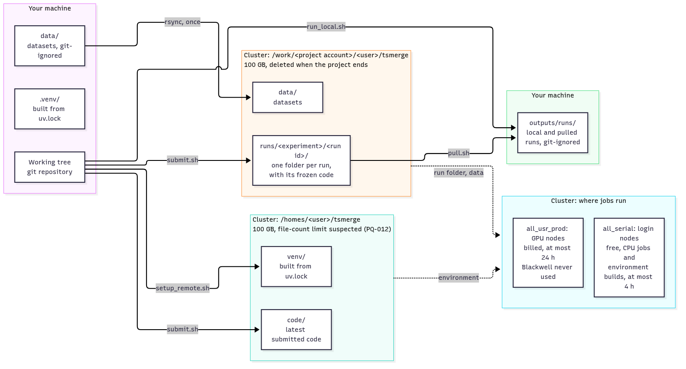
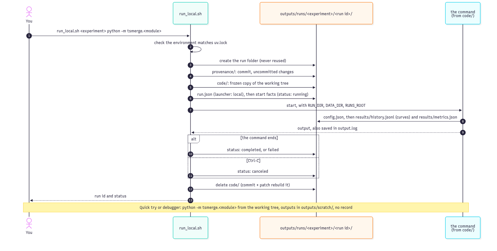
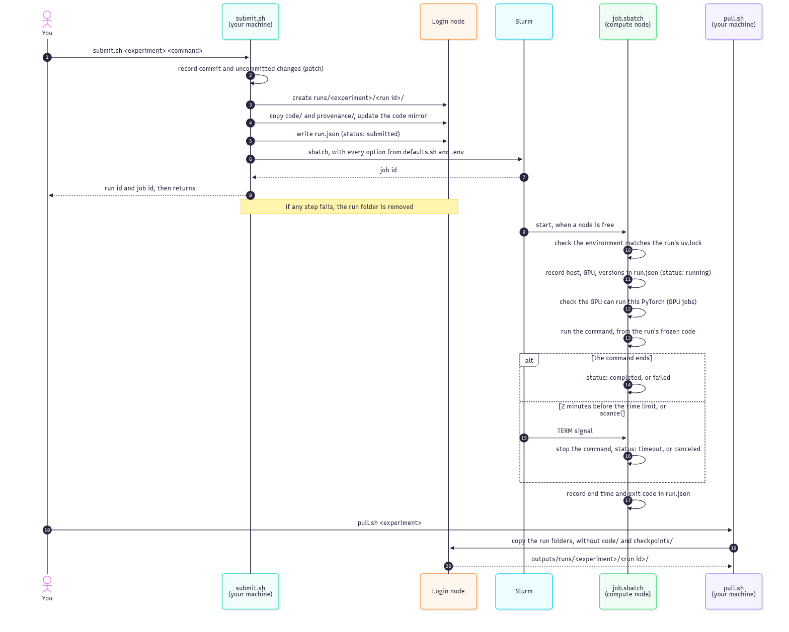
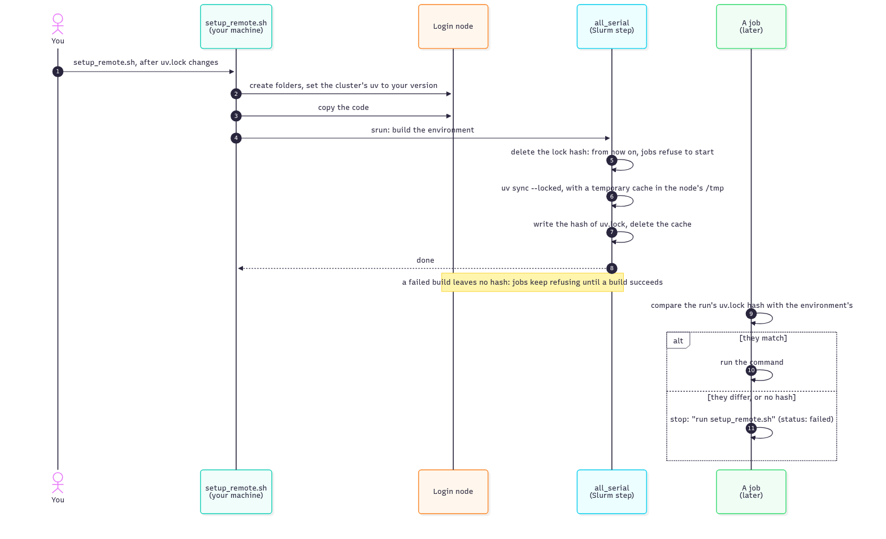

# Running: locally and on the cluster

How to run things day to day: on your machine, and on the Unimore cluster.

- One-time preparation (your machine, your cluster account): [setup.md](setup.md).
- Facts and rules of the cluster itself: [cluster.md](cluster.md).
- Every option and file of the cluster scripts: [scripts/cluster/README.md](../../scripts/cluster/README.md).

## The model: local first

**Your machine is the source of truth; the cluster only computes.**

- You edit, commit and keep results locally.
- **Code changes only locally**, never on the cluster, even while debugging there.
- Each cluster run gets a **frozen copy** of the code it was submitted with, so you can keep editing, or submit other versions, while it waits in the queue.
- Results come back to your machine with `pull.sh`. Cluster storage is not backed up, and is deleted when access ends ([cluster.md](cluster.md#storage)).



*Source: [diagrams/machines-and-storage.mmd](diagrams/machines-and-storage.mmd)*

- **`outputs/`** (git-ignored) holds everything generated on your machine, and nothing else:
  - `runs/`: local runs and pulled cluster runs ([runs.md](runs.md));
  - `scratch/`: outputs of quick tries and debug sessions, overwritten each time;
  - `jobs.log`: one line per submitted job: job id, run id, experiment, date, command;
  - `expert-reviews/`: the reports of the expert-review skill ([.claude/README.md](../../.claude/README.md)).

The run folder layout, and what each run records: [runs.md](runs.md).

## Start each session

After WSL or the machine restarts, or when the cluster connection has closed (8 hours without use, or a network drop):

```bash
scripts/start-session.sh
```

- It asks for your SSH key passphrases and the cluster password, once, and every terminal and script reuses them.
- Without it, git pushes and the cluster scripts fail with `Permission denied`.
- What it does and why: [scripts/README.md](../../scripts/README.md#start-sessionsh). Setting it up: [setup.md](setup.md#unlock-everything-once-per-session).

## Running locally

Experiment code lives in the [`tsmerge/`](../../tsmerge/README.md) package and runs as a module, `python -m tsmerge.<module>`, always from the repository root ([PD-030](decisions/PD-030-experiment-code.md)). There are two ways to run it:

| | A recorded run | A quick try |
|---|---|---|
| Command | `scripts/run_local.sh <experiment> python -m tsmerge.<module> [args…]` | `uv run python -m tsmerge.<module> [args…]` |
| Run folder and `run.json` | yes, in `outputs/runs/<experiment>/<run id>/`, like a cluster run | no: outputs go to `outputs/scratch/`, overwritten each time |
| Runs from | a frozen copy of the code, deleted at the end: keep editing while it runs | your working tree |
| Use it for | results you may keep or compare | trying things out, and debugging |

```bash
scripts/run_local.sh hello python -m tsmerge.hello
#   run 20261102-141503-a3f9 (hello), commit a1b2c3d -> outputs/runs/hello/20261102-141503-a3f9
#   ... the command's output, also saved in output.log ...
#   run 20261102-141503-a3f9: completed (exit code 0)
```



*Source: [diagrams/local-run.mmd](diagrams/local-run.mmd)*

- **Ctrl-C** stops a recorded run and records it as `canceled`.
- `SWEEP=<id>` and `INPUTS="<experiment>/<run id> …"` work as for `submit.sh`.
- The environment is checked against `uv.lock` before the run starts (`uv sync --locked`).
- Experiments use the local GPU when PyTorch sees one (`--device auto`, the default), the CPU otherwise.
- **WSL2:** the GPU's memory is shared with Windows apps; check `nvidia-smi` before a long local run ([setup.md](setup.md#5-gpu-and-cuda-optional)).

Why it works this way: [PD-029](decisions/PD-029-local-runs.md).

### From VS Code

The repository's tasks and debug configurations run all of the above from the editor ([PD-031](decisions/PD-031-vs-code.md)):

- **Tasks** (*Terminal* → *Run Task…*): run locally, submit to the cluster, status, logs, pull, set up the cluster environment, start the session, checks, render diagrams, runs summary. They ask for the experiment, the module or the job id.
- **Debugging** (*Run and Debug*): *Debug a module* (asks e.g. `tsmerge.hello`) or *Debug current file*, from the working tree, with breakpoints. Debug sessions are quick tries: their outputs go to `outputs/scratch/`.
- A failed recorded run is reproduced in the debugger with the same module and arguments (in its `run.json`'s `command`).
- Setting up VS Code and its extensions: [setup.md](setup.md#9-vs-code).

## Datasets

Datasets live outside the code ([PD-020](decisions/PD-020-dataset-location.md)):

- **locally:** in `data/` at the repository root (git-ignored), or wherever `DATA_DIR` in `.env` points. Recorded runs (`run_local.sh`) and the VS Code debugger read `.env` by themselves; for a quick try in a terminal, add `--env-file .env`: `uv run --env-file .env python -m tsmerge.<module>`;
- **on the cluster:** in the work area's `data/` folder; jobs find it as `DATA_DIR`.

Upload a dataset once, preferably as a few large files:

```bash
rsync -az --partial data/<dataset>/ ailb:/work/<project account>/<username>/tsmerge/data/<dataset>/
```

`--partial` makes an interrupted upload resume instead of restarting. Large copies go through the login node: the cluster's data-transfer node isn't reachable from outside the Unimore network ([PD-024](decisions/PD-024-large-transfers.md)).

## Running on the cluster

### Where jobs run

| Work | Partition | Why |
|---|---|---|
| GPU training and evaluation | `all_usr_prod` | [PD-002](decisions/PD-002-cluster-partition.md) |
| CPU-only work (data preparation, aggregating results) | `all_serial`, free: `CLUSTER_PROFILE=cpu scripts/cluster/submit.sh …` | [PD-002](decisions/PD-002-cluster-partition.md), [PD-022](decisions/PD-022-cpu-jobs.md) |
| Very light GPU work, free | `all_serial`, on its P100 GPUs only (the K80s are too old): `CLUSTER_PROFILE=cpu SBATCH_OPTS="--constraint=gpu_P100_16G --gres=gpu:1" scripts/cluster/submit.sh …`. Not verified yet: [PQ-013](questions/PQ-013-p100-driver.md) | [PD-002](decisions/PD-002-cluster-partition.md) |
| Never | `boost_usr_prod` | reserved for projects that need high-memory GPUs ([PD-002](decisions/PD-002-cluster-partition.md)) |

- **CPU-only jobs** (data preparation, aggregating results): `CLUSTER_PROFILE=cpu scripts/cluster/submit.sh …`. No GPU is requested or checked, and the job runs on `all_serial` (free, at most 4 hours), with the same run folder and records as GPU runs. For heavy or long CPU work, add `CLUSTER_CPU_PARTITION=all_usr_prod` (billed, up to 24 hours). Why: [PD-022](decisions/PD-022-cpu-jobs.md).

- **GPU models:** jobs run only on the models allowed in `scripts/cluster/defaults.sh`; Blackwell is always excluded, because this PyTorch build can't run on it ([PD-004](decisions/PD-004-gpu-allow-list.md)). All other models are allowed, high-memory ones included as part of the mixed list ([PD-027](decisions/PD-027-gpu-pool.md)). To compare runs on identical hardware, narrow the list for a sweep to one family of at most 24 GB, e.g. `CLUSTER_GPU_SUBSET="gpu_2080_11G gpu_2080Ti_11G" scripts/cluster/submit.sh …` (only allowed models are accepted).
- **Every Slurm option** (account, partition, GPUs, time limit, …) is preset: you pass only the experiment name and the command. Defaults and how to override them: [scripts/cluster/README.md](../../scripts/cluster/README.md#commands).

### The cycle



*Source: [diagrams/cluster-run.mmd](diagrams/cluster-run.mmd)*

```bash
scripts/cluster/submit.sh hello python -m tsmerge.hello
#   run 20261102-141503-a3f9 (hello), commit a1b2c3d
#   submitted job 123456 -> /work/…/runs/hello/20261102-141503-a3f9

scripts/cluster/status.sh            # your queue
scripts/cluster/status.sh 123456     # one job: state, exit code, elapsed time, node

scripts/cluster/logs.sh 123456       # the end of the job's output, while it runs
scripts/cluster/pull.sh hello        # bring the experiment's runs back into outputs/runs/
```

- `submit.sh` returns at once: the job runs on its own, even if you close your machine.
- **Don't edit files during the few seconds a submission takes:** the run records the working tree as it was when the submission started.
- **If a submission fails** (for example `sbatch` rejects an option, or the budget is spent), `submit.sh` says which step failed and removes the half-created run folder, so no run is left marked "submitted" without a job.
- Before submitting, it checks the GPU lists against the cluster, and warns if a GPU model appeared or disappeared ([PD-004](decisions/PD-004-gpu-allow-list.md)).
- Each run's `run.json` records what ran, where and how it ended; `output.log` holds the job's output.
- **How a run ended** is always recorded in `run.json`'s `status` (`completed`, `failed`, `timeout`, `canceled`, `stopped`; meanings in [runs.md](runs.md#how-a-run-ended-status)). A run gets its time limit **minus 2 minutes**, and `sacct` shows runs stopped at the limit as `FAILED`: trust `run.json`.
- **Sweeps:** give the runs of one comparison the same sweep id, so they can be grouped later: `SWEEP=<id> scripts/cluster/submit.sh …`. It's recorded in each run's `run.json`.
- **Runs that use earlier runs** (e.g. merging fine-tuned checkpoints): list them with `INPUTS="<experiment>/<run id> …" scripts/cluster/submit.sh …`. They are recorded in `run.json`, and the program finds them under `RUNS_ROOT` ([runs.md](runs.md#what-a-run-provides)).
- **What each run records** (`run.json`, `config.json`), its folder layout and where runs live: [runs.md](runs.md).
- After a change to `uv.lock` or to your uv version, rerun `scripts/cluster/setup_remote.sh` first: jobs refuse to run against an outdated environment, or while a rebuild is in progress.
- **Don't rebuild the environment while jobs are running or queued:** there is one environment, rebuilt in place. Running jobs could load a mix of old and new packages, and queued jobs submitted with the old `uv.lock` will refuse to start.
- **Uncommitted changes:** `submit.sh` warns, and the run records them in `provenance/patch.diff`, so it can still be rebuilt exactly. For results you'll report, prefer submitting from a clean tree.

### The cluster environment



*Source: [diagrams/environment-build.mmd](diagrams/environment-build.mmd)*

Why it works this way: [PD-008](decisions/PD-008-environment-integrity.md) (the lock-hash guard) and [PD-005](decisions/PD-005-uv-cache-on-the-cluster.md) (the temporary cache).

### Rebuilding a run's code

A run's `run.json` names its commit; uncommitted changes, new files included, are in its `provenance/patch.diff`. To see exactly the code a run executed:

```bash
git worktree add /tmp/run-code <git_commit from run.json>
git -C /tmp/run-code apply --binary outputs/runs/<experiment>/<run id>/provenance/patch.diff
```

The second line is needed only when the run's `git_dirty` is `true`. Remove the folder afterwards with `git worktree remove /tmp/run-code`.

## Durations and budget

After pulling, see how long runs took, how close they came to their time limit, and roughly what they cost:

```bash
uv run --locked python scripts/runs_summary.py            # all pulled runs
uv run --locked python scripts/runs_summary.py <experiment>
```

- **Choosing `CLUSTER_TIME`:** take the durations of similar runs, add a margin, and remember a run gets its limit minus 2 minutes. A run that hits its limit restarts from scratch.
- **Cost:** the `stdh` column estimates the standard hours billed (one GPU-hour costs at least 6; `all_serial` and local runs are free). The official figure is `susage` on the cluster.

Why: [PD-023](decisions/PD-023-durations-and-budget.md).

## Interactive work and debugging on the cluster

Most debugging happens locally. When it must happen on the cluster:

- **An interactive shell through Slurm**, never directly on a login node:

  ```bash
  # a GPU, on the debug QOS (high priority, at most 1 h)
  srun --partition=all_usr_prod --qos=all_qos_dbg --account=<project account> \
       --constraint="<allowed GPU models>" --gres=gpu:1 --time=00:30:00 --pty bash

  # CPU-only or light work, free of charge
  srun --partition=all_serial --account=<project account> --time=01:00:00 --pty bash
  ```

  Then activate the environment: `source /homes/<user>/tsmerge/venv/bin/activate`.
- **VS Code:** connect with *Remote-SSH* to a login node, open the code mirror (`/homes/<user>/tsmerge/code/`), and run the debugger inside an `srun` session ([cluster documentation](https://ailb-web.ing.unimore.it/coldfront/documentation/Zf44P)).
- **Fix the code locally**, then resubmit: the mirror is overwritten at every submit.

## Safety net

- **Pull regularly:** at least at the end of each working day, `scripts/cluster/pull.sh`. Checkpoints only when needed: `pull.sh --checkpoints <experiment>`.
- **Mind the account's expiry:** check with `sexpiration` on the cluster; when it ends, the work folder is deleted at once ([cluster.md](cluster.md#storage)).
- **Back up your results:** after pulling, copy `outputs/` (runs and review reports alike) to a second place (another drive, a cloud-synced folder). It's git-ignored and exists only on this machine:

  ```bash
  rsync -a --exclude 'checkpoints/' outputs/ <backup folder>/tsmerge-outputs/
  ```

  Drop `--exclude 'checkpoints/'` to include model weights.
- **Push before submitting runs you'll report:** a run records its commit; an unpushed commit that is later amended or rebased disappears. `submit.sh` warns about unpushed commits.

Why: [PD-025](decisions/PD-025-run-safety.md).
