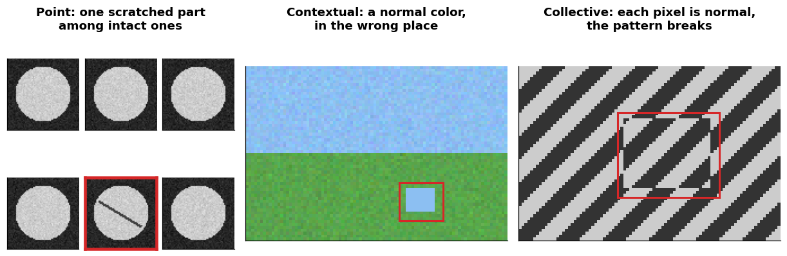
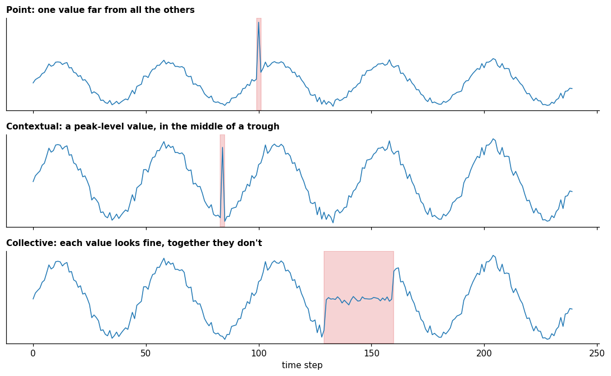

# Kinds of anomalies

**In one sentence:** an anomaly can be a single item far from the rest, an item that is wrong only in its context, or a group that is wrong only as a whole, in any kind of data.

- **Builds on:** [Anomaly detection](anomaly-detection.md).
- **Used by:** [Methods](methods.md), [Anomaly detection in time series](../time-series/tasks/anomaly-detection.md), [Normalization in time series](../time-series/data-preparation/normalization.md).

## Three kinds

The survey distinguishes three kinds ([pang2021deep](../../literature/pang2021deep.md), p. 4):

| Kind | What it is |
|---|---|
| **Point** | a single item far from all the others |
| **Contextual** (conditional) | an item that is normal in general, but not in its context, e.g. a "sudden temperature drop/increase in a particular temporal context" |
| **Collective** (group) | a group that is abnormal as a whole, even if each member alone looks normal |

## Examples across domains

The same three kinds appear in any kind of data. The examples below are illustrations:

| Domain | Point | Contextual | Collective |
|---|---|---|---|
| **Payments** | one payment far larger than anything the customer has ever made | a purchase that is ordinary at home, but made abroad in the middle of the night | many tiny purchases in a row, each harmless, together a sign that a stolen card is being tested |
| **Images** | a photo of a scratched part among photos of intact parts | a car on a pedestrian path: the object is normal, its place is not | a woven fabric whose threads each look fine, but whose pattern is misaligned over a patch |
| **Computer networks** | one connection moving far more data than any other | a login that is normal during working hours, but not at 3 a.m. | many small connection attempts, each normal, together a scan of the network |
| **Medicine** | a lab value far outside any healthy range | a heart rate of 150 beats per minute: normal while running, abnormal at rest | heartbeats each within range, whose rhythm taken together is irregular |
| **Sensors and time series** | a reading ten times the usual value | heating at full power on a summer afternoon | a machine's regular rhythm stopping for an hour |

The same three kinds, first on images:

- **Point:** one image differs from all the others: the scratched part.
- **Contextual:** the patch's color is normal in the sky, but wrong in the grass.
- **Collective:** every pixel has a normal value; only the shifted stripes, taken together, break the pattern.

Then on a time-based signal:

- **Point:** the value would be suspicious anywhere.
- **Contextual:** the same value appears elsewhere as normal (at every peak); only its place makes it wrong. The context can be a moment, a place, an activity, or any other condition.
- **Collective:** no single value is extreme; the anomaly is the pattern they form together.

## Why it matters

The kind decides what a method must look at:

- a **point** anomaly can be found by looking at one item at a time;
- a **contextual** one needs the context, e.g. the time, the place or the activity;
- a **collective** one needs a group of items seen together, e.g. a sequence of payments, a patch of an image, or a stretch of a time series.

## Key points

- **Point:** one item far from the rest.
- **Contextual:** an item that is wrong only in its context.
- **Collective:** a group that is wrong only as a whole.
- The kind of anomaly decides how much context a method must see.

## Sources

- [pang2021deep](../../literature/pang2021deep.md): the three kinds and the temperature example. The examples across domains are illustrations.
