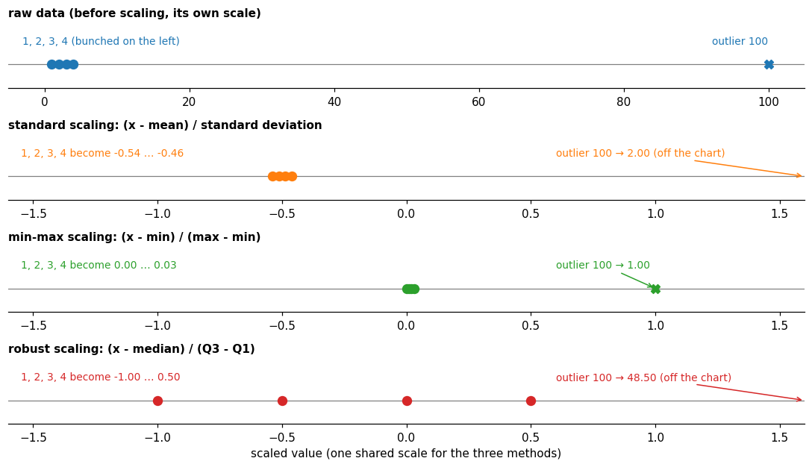

# Normalization

**In one sentence:** normalization rescales each feature to a comparable range, so that no feature dominates just because of its units, and different methods treat outliers very differently.

- **Builds on:** nothing: a starting point.
- **Used by:** [Normalization in time series](../time-series/data-preparation/normalization.md).

## Why normalize

Raw features can have very different ranges: a temperature in degrees, a power load in kilowatts, a count in thousands.

- **Distances get dominated:** many methods compare items by distance, and "if one of the features has a broad range of values, the distance will be governed by this particular feature" ([Feature scaling][wiki]).
- **Training is slower:** "gradient descent converges much faster with feature scaling than without it" ([Feature scaling][wiki]).

Normalization puts every feature on a comparable scale.

### Normalization or scaling?

- **Usually synonyms:** feature scaling "is also known as data normalization" ([Feature scaling][wiki]), and the methods carry either name: min-max scaling or min-max normalization, standard scaling or z-score normalization.
- **One exception:** scikit-learn uses the word for something else: "Normalization is the process of scaling individual samples to have unit norm" ([scikit-learn: preprocessing][sk-pre]). It rescales each row, not each feature. This doc means per-feature scaling.

## The main methods

| Method | Formula | Result |
|---|---|---|
| **Standard scaling** (z-score) | $x' = \dfrac{x - \bar{x}}{\sigma}$ | mean 0, standard deviation 1 |
| **Min-max scaling** | $x' = \dfrac{x - \min(x)}{\max(x) - \min(x)}$ | values between 0 and 1 |
| **Robust scaling** | $x' = \dfrac{x - Q_2(x)}{Q_3(x) - Q_1(x)}$ | median 0, middle half of the values spread over 1 |

- $\bar{x}$ is the mean and $\sigma$ the standard deviation of the feature.
- $Q_1, Q_2, Q_3$ are its quartiles: the 25th, 50th (the median) and 75th percentiles. $Q_3 - Q_1$ is the interquartile range (IQR), the spread of the middle half of the values.

All three are defined in [Feature scaling (Wikipedia)][wiki]. Robust scaling "is designed to be robust to outliers" ([Feature scaling][wiki]).

## What they do to the data

All three only shift and stretch the values: the order of the values and the shape of their distribution stay the same. What changes is the center and the spread, and how much a single extreme value can affect both.

### A small example

Take the values 1, 2, 3, 4 and one outlier, 100.

| Method | 1, 2, 3, 4 become | The outlier becomes |
|---|---|---|
| Standard scaling | −0.54, −0.51, −0.49, −0.46 | 2.00 |
| Min-max scaling | 0.00, 0.01, 0.02, 0.03 | 1.00 |
| Robust scaling | −1.00, −0.50, 0.00, 0.50 | 48.50 |

- **Raw (top):** the four normal values are bunched far from the outlier, on the data's own scale.
- **Standard and min-max scaling** let the outlier set the scale: it inflates the standard deviation, or becomes the maximum, so the four normal values are squeezed into a tiny range. Standard scaling "is sensitive to outliers" ([StandardScaler][sk-standard]).
- **Robust scaling** uses the median and the IQR, which one outlier barely moves: the normal values keep their spread, and the outlier stands out.

Without the outlier, standard scaling would spread 1, 2, 3, 4 over −1.34 to 1.34, and min-max over 0 to 1.

## Which one to use

| Method | Pros | Cons | Best fit |
|---|---|---|---|
| **Standard scaling** | centers on 0 with spread 1, which many methods expect | an outlier inflates the spread and squeezes the other values | data without strong outliers, for methods that expect standardized data |
| **Min-max scaling** | a fixed range, 0 to 1; keeps 0 and 1 as they are | one outlier sets the range; new values beyond the training minimum or maximum fall outside 0 to 1 | bounded data, binary features, inputs that must lie in a fixed range |
| **Robust scaling** | the median and the IQR barely move with a few outliers | no fixed range; the outliers stay, with large values | data with outliers |

- **Standard scaling:** gradient-based and distance-based methods "often assume approximately standardized data (centered features with unit variances)" ([scikit-learn: scalers and outliers][sk-compare]).
- **Min-max scaling:** its motivation "includes robustness to very small standard deviations of features and preserving zero entries in sparse data" ([scikit-learn: preprocessing][sk-pre]).
- **Robust scaling:** "If your data contains many outliers, scaling using the mean and variance of the data is likely to not work very well"; robust scaling is the replacement ([scikit-learn: preprocessing][sk-pre]).
- **No scaling:** decision trees, and models built from them, are "robust to arbitrary scaling of the data" ([scikit-learn: scalers and outliers][sk-compare]).

## Learn the scaling on the training data only

The mean, standard deviation, minimum, maximum or quartiles are themselves learned from data. They must come from the training data only, and the same values are then applied to the test data. Using statistics from the test data leaks information about it ([splitting](../time-series/data-preparation/splitting.md)).

## Constant and binary features

- **A constant feature** has a standard deviation of 0, and a range of 0: standard and min-max scaling would divide by zero. Libraries handle it differently; scikit-learn, for example: "If a variance is zero, we can't achieve unit variance, and the data is left as-is, giving a scaling factor of 1" ([StandardScaler][sk-standard]).
- **A binary feature** (0 or 1) stays 0 and 1 under min-max scaling. Standard scaling maps it to two other values, set by how often each value occurs.

What this means for time series, and for anomaly detection in particular: [normalization in time series](../time-series/data-preparation/normalization.md).

## Key points

- **Normalization** puts features on comparable scales, so no feature dominates by its units, and training converges faster; it is usually a synonym of scaling.
- **Standard scaling:** mean 0, standard deviation 1. **Min-max:** between 0 and 1. **Robust:** median 0, scaled by the interquartile range.
- They keep the order and the shape of the data; an **outlier** squeezes the other values under standard and min-max scaling, much less under robust scaling.
- **Which one:** standard scaling without strong outliers, min-max for bounded or binary data, robust scaling with outliers; tree-based models need none.
- **Learn the statistics on the training data only.**
- **Constant features** can't be scaled by their spread (it's 0); **binary features** stay 0 and 1 only under min-max scaling.

## Sources

- [Feature scaling (Wikipedia)][wiki]: motivation, min-max, standard and robust scaling. Read on 2026-11-10.
- scikit-learn, [StandardScaler][sk-standard]: sensitivity to outliers, constant features left as-is. Read on 2026-11-10.
- scikit-learn, [Preprocessing data][sk-pre]: why min-max scaling, robust scaling for data with outliers, normalization per sample. Read on 2026-11-10.
- scikit-learn, [Compare the effect of different scalers on data with outliers][sk-compare]: what methods expect, trees need no scaling. Read on 2026-11-10.

[wiki]: https://en.wikipedia.org/wiki/Feature_scaling
[sk-standard]: https://scikit-learn.org/stable/modules/generated/sklearn.preprocessing.StandardScaler.html
[sk-pre]: https://scikit-learn.org/stable/modules/preprocessing.html
[sk-compare]: https://scikit-learn.org/stable/auto_examples/preprocessing/plot_all_scaling.html
