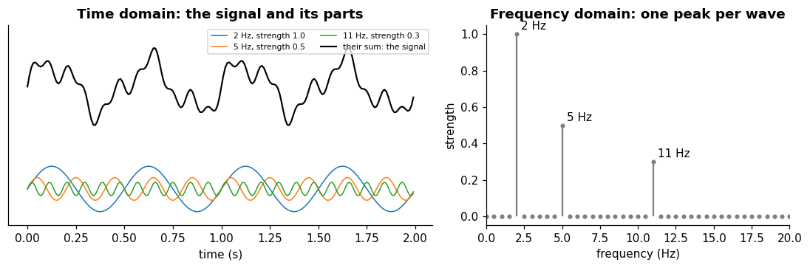
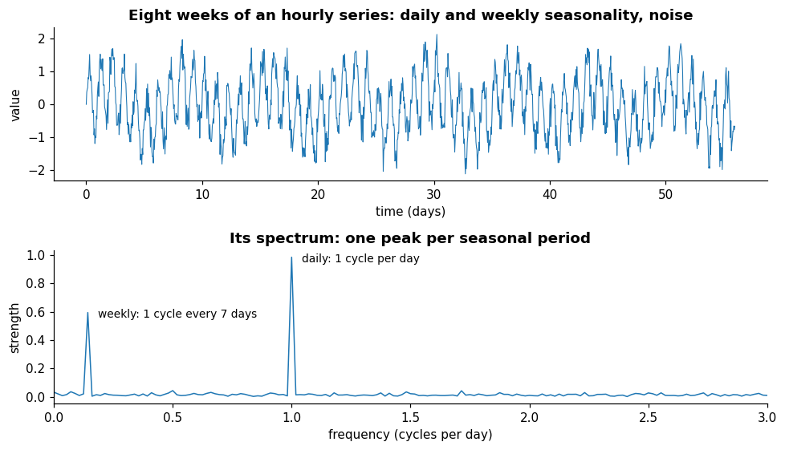

# Fourier transform

**In one sentence:** the Fourier transform rewrites a signal as a sum of sine waves, telling how strong each frequency is and where each wave starts, so patterns that repeat show up as peaks.

- **Builds on:** [Signals](signals.md), [Sampling](sampling.md).
- **Used by:** [Patterns](../time-series/structure/patterns.md), [Decomposition](../time-series/structure/decomposition.md), [Forecasting models](../time-series/models/forecasting-models.md).

## The idea

A signal can be seen as a sum of sine waves, each with its own frequency, strength and starting point.

The Fourier transform finds those waves. It "takes a function as input and outputs another function that describes the extent to which various frequencies are present in the original function" ([Fourier transform][ft]).

- **Left:** three sine waves, at 2, 5 and 11 Hz with strengths 1, 0.5 and 0.3, and their sum, which is the signal you would record.
- **Right:** the transform of the sum. It finds the three waves again: one peak at each frequency, as tall as the wave's strength.

## Two views of one signal

The signal over time and its frequency content are two views of the same thing, the **time domain** and the **frequency domain** ([Signals](signals.md#kinds-of-signals)).

- The transform "can simply be interpreted as switching the time domain and the frequency domain, with the inverse Fourier transform switching them back" ([Fourier transform][ft]).
- Going there and back loses nothing, as long as both parts of the result are kept (next section).

## Strength and phase

"The output of the transform is a complex valued function of frequency", which "conveys both amplitude and phase" of each frequency ([Fourier transform][ft]):

- **amplitude** (strength): how much of that frequency the signal contains;
- **phase:** where in its cycle that wave starts.

A plot of strengths alone, like the spectra on this page, is easier to read but loses the phase. And "the phase portion is required to uniquely define the signal" ([Frequency domain][fd]).

## For sampled data: the discrete Fourier transform

A recorded signal is a finite list of samples, so in practice the **discrete Fourier transform (DFT)** is used.

- **What it does:** it turns "a finite sequence of equally-spaced samples" into a sequence of the same length, describing the signal's frequency content ([Discrete Fourier transform][dft]).
- **The formula,** for $N$ samples $x_0, \dots, x_{N-1}$ ([Discrete Fourier transform][dft]):

$$X_k = \sum_{n=0}^{N-1} x_n \, e^{-i 2\pi \frac{k}{N} n}, \qquad k = 0, \dots, N-1$$

- **What $k$ means:** component $k$ completes $k$ cycles over the $N$ samples. With $f_s$ samples per second, its frequency is $k \, f_s / N$.
- **Resolution:** neighboring components are $f_s / N$ apart. A longer stretch of data (larger $N$) separates frequencies more finely; a short one blurs close frequencies together. This loss of detail from a limited stretch is called **leakage** ([Discrete Fourier transform][dft]).
- **The highest frequency:** for a real-valued signal, the DFT "is symmetric around the middle point, and so only half of the transform points are needed to reconstruct the original signal" ([Discrete Fourier transform][dft]).
  - The useful half reaches the **Nyquist frequency**, $f_s/2$.
  - Nothing faster can be seen in the samples, as [sampling](sampling.md#sampling-fast-enough) explains.

## The fast Fourier transform

The **fast Fourier transform (FFT)** is "an algorithm that computes the discrete Fourier transform (DFT), or its inverse" ([Fast Fourier transform][fft]).

- **Same result, much faster:** it reduces the cost from $O(n^2)$ to $O(n \log n)$ for $n$ samples ([Fast Fourier transform][fft]).
- **Why it matters:** computing the spectrum of a long signal, or of every short stretch a model reads, becomes cheap. In practice, "taking the Fourier transform" of sampled data means running an FFT.

## Finding periods in a time-based signal

A pattern that repeats every $p$ steps is a wave with frequency $1/p$ cycles per step, so it shows up as a peak at that frequency.

- **Top:** eight weeks of a signal sampled every hour, with a pattern that repeats every day and one that repeats every week, plus noise. The two patterns are hard to separate by eye.
- **Bottom:** its spectrum has one clear peak per repeating pattern: at 1 cycle per day (period 24 hours) and at 1 cycle every 7 days (period 168 hours). The noise spreads thinly over all frequencies.

Methods that take a signal apart into a slow part, repeating patterns and a rest need these periods as input ([where Fourier fits](../time-series/structure/decomposition.md#where-fourier-fits)).

Deep learning models for time-based signals use the same idea:

- **TimesNet** finds a signal's dominant periods with an FFT. It keeps the $k$ frequencies with the largest amplitudes, and turns each frequency $f_i$ into a period $p_i = \lceil T / f_i \rceil$ for a signal of length $T$ ([wu2023timesnet](../../literature/wu2023timesnet.md), p. 4).
- **A survey of such models** counts Fourier analysis among the basic modules shared by many models. Some use it to pick periods or keep chosen frequencies; others model the signal directly in the frequency domain ([wang2026deep](../../literature/wang2026deep.md), Section 3.3, pp. 4–5).

## Key points

- The Fourier transform rewrites a signal as a **sum of sine waves**: for each frequency, an **amplitude** (how strong) and a **phase** (where it starts).
- Time domain and frequency domain are two views of the same signal; both amplitude and phase are needed to go back.
- For sampled data, the **DFT** of $N$ samples gives components $f_s/N$ apart, up to the **Nyquist frequency** $f_s/2$; longer stretches separate frequencies more finely.
- The **FFT** computes the DFT in $O(n \log n)$ instead of $O(n^2)$.
- A pattern that repeats every $p$ steps shows up as a **peak at frequency $1/p$**: the spectrum finds periods.

## Sources

- [Fourier transform (Wikipedia)][ft]: definition, complex output with amplitude and phase, switching domains. Read on 2026-11-09.
- [Discrete Fourier transform (Wikipedia)][dft]: definition and formula, symmetry for real signals, leakage. Read on 2026-11-09.
- [Fast Fourier transform (Wikipedia)][fft]: the algorithm and its cost. Read on 2026-11-09.
- [Frequency domain (Wikipedia)][fd]: the phase is needed to define the signal. Read on 2026-11-09.
- [wu2023timesnet](../../literature/wu2023timesnet.md): period discovery with the FFT.
- [wang2026deep](../../literature/wang2026deep.md): Fourier analysis as a basic module of deep learning models for time-based signals.

[ft]: https://en.wikipedia.org/wiki/Fourier_transform
[dft]: https://en.wikipedia.org/wiki/Discrete_Fourier_transform
[fft]: https://en.wikipedia.org/wiki/Fast_Fourier_transform
[fd]: https://en.wikipedia.org/wiki/Frequency_domain
