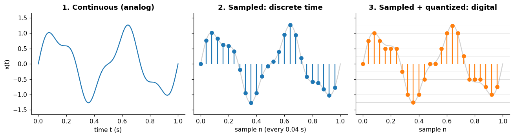
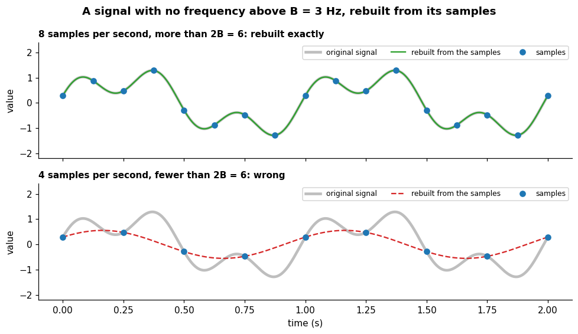
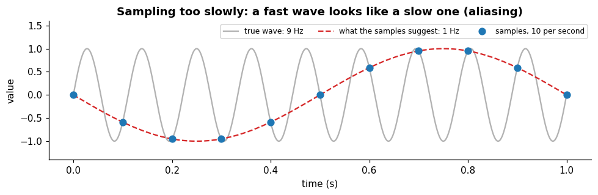

# Sampling

**In one sentence:** a computer can only store a signal as numbers taken at separate moments and rounded to a set of levels, and how fast those numbers are taken decides what the signal can still show.

- **Builds on:** [Signals](signals.md).
- **Used by:** [Fourier transform](fourier-transform.md), [Time series](../time-series/time-series.md).

## Continuous vs discrete

A signal can be continuous or discrete:

- **physical quantities** (pressure, temperature, voltage) are continuous, and **recording** them on a computer makes them discrete;
- **some signals are discrete by nature:** a DNA sequence, a daily closing price, a monthly count. There is nothing between two steps to record.

| | Continuous | Discrete |
|---|---|---|
| **Defined** | at every instant: "defined at every time t in an interval" ([Signal][signal]) | only at separate points, numbered 0, 1, 2, … |
| **Written** | $x(t)$, with $t$ a real number | $x[n]$, with $n$ an integer |
| **Typical source** | the physical world | a measuring device or a computer, or data that comes in steps by nature |

You turn a continuous signal into a discrete one by **sampling**: measuring it at regular intervals. "Sampling is the reduction of a continuous-time signal to a discrete-time signal" ([Sampling][sampling]).

- The **sampling period** $T$ is the time between two samples.
- The **sampling rate** $f_s = 1/T$ is how many samples are taken per second; "for example, 48 kHz is 48,000 samples per second" ([Sampling][sampling]).
- Audio, for instance, "is typically sampled at 44.1 kHz (CD), 48 kHz, 88.2 kHz, or 96 kHz" ([Sampling][sampling]).

There is a second step on the way to a computer: **quantization**, rounding each value to one of a limited set of levels. An analog-to-digital converter "can be modeled as two processes: sampling and quantization" ([Quantization][quantization]):

- **sampling** makes **time** discrete;
- **quantization** makes the **values** discrete.

A **digital** signal is both sampled and quantized; an **analog** signal is neither ([Signal][signal]).

What the three panels show:

1. **Continuous:** a smooth curve, a value at every instant.
2. **Sampled:** only the values every 0.04 seconds remain (25 samples per second); the gray curve is what was lost between them.
3. **Sampled and quantized:** each sample is also rounded to the nearest gray line (steps of 0.25). The small rounding error is called **quantization error** ([Quantization][quantization]).

Everything a computer stores is digital.

## Sampling fast enough

Sampling throws away what happens between samples. How fast must you sample to lose nothing important?

The **Nyquist–Shannon sampling theorem** answers it: a signal with no frequencies above $B$ hertz is completely determined by its samples if you take more than $2B$ samples per second ([Nyquist–Shannon][nyquist]).

Half the sampling rate, $f_s/2$, is called the **Nyquist frequency** ([Nyquist–Shannon][nyquist]).

### Rebuilding the signal from its samples

"Completely determined" means exactly that: from the samples alone, the whole continuous curve can be rebuilt, every value between the samples included.

- **How:** each sample is replaced by a smooth bump centered on it and scaled by its value, and the bumps add up to the original curve.
  - The bump is the sinc function, $\mathrm{sinc}(x) = \sin(\pi x)/(\pi x)$: it equals 1 at its own sample and 0 at every other sample.
  - This is the **Whittaker–Shannon interpolation formula**, "a method to construct a continuous-time bandlimited function from a sequence of real numbers" ([Whittaker–Shannon][whittaker]):

$$x(t) = \sum_{n=-\infty}^{\infty} x[n]\, \mathrm{sinc}\left(\frac{t - nT}{T}\right)$$

- **The symbols:** $x[n]$ is the $n$-th sample and $T$ the sampling period. The sum runs over all samples, before and after $t$; with only a short stretch of samples, the rebuild is approximate near its ends.
- **The threshold** $2B$ is called the **Nyquist rate**: "the sample rate must exceed the Nyquist rate for the samples to suffice to represent $x(t)$" ([Nyquist–Shannon][nyquist]).
- **Why more than $2B$, not exactly $2B$:** sampled exactly $2B$ times per second, a sine wave at frequency $B$ can be caught at its zero crossings, giving samples that are all 0. That's why careful statements of the theorem require "no sinusoidal component at exactly frequency $B$" ([Nyquist–Shannon][nyquist]).

- **Top, 8 samples per second (more than $2B = 6$):** the curve rebuilt from the samples lies exactly on the original.
- **Bottom, 4 samples per second (fewer than 6):** the samples fit a slower curve just as well, and the formula rebuilds that one. The 3 Hz part of the signal is lost, disguised as a slower wave: this is aliasing.

### Sampling too slowly: aliasing

Sample too slowly, and fast changes don't just disappear: they **disguise themselves as slow ones**.

This is called **aliasing**: "any frequency component above $f_s/2$ is indistinguishable from a lower-frequency component" ([Nyquist–Shannon][nyquist]).

So what matters is the **highest frequency present in the signal**, not just the fastest one you care about: a fast component you don't care about still folds down into the slower range you do care about, and corrupts it.

When the sampling rate is fixed, the signal "is usually filtered to reduce its high frequencies to acceptable levels before it is sampled", with an **anti-aliasing filter** ([Nyquist–Shannon][nyquist]).

The blue dots are 10 samples per second of a wave that repeats 9 times per second. Looking only at the dots, you'd draw the red dashed wave, which repeats once per second. The samples can't tell the two apart.

**Why it matters:** the sampling rate of a dataset limits what a model can ever see in it. A series sampled once an hour can't show a pattern that repeats every 30 minutes.

That pattern either vanishes or shows up disguised as a slower one. So choosing, or changing, the sampling rate is a real modeling choice.

## Key points

- **Sampling** makes time discrete; **quantization** makes values discrete; a **digital** signal has both.
- More than **$2B$ samples per second** determine a signal with no frequency above $B$ completely: the sinc formula rebuilds every value between the samples.
- Sample at **more than twice** the highest frequency present in the signal, or filter out the faster parts before sampling; otherwise fast components turn into fake slow ones (**aliasing**).

## Sources

- [Signal (Wikipedia)][signal]: analog and digital, continuous and discrete time. Read on 2026-11-08.
- [Sampling (signal processing) (Wikipedia)][sampling]: sampling, sampling period and rate, audio rates. Read on 2026-11-08.
- [Quantization (signal processing) (Wikipedia)][quantization]: quantization, quantization error. Read on 2026-11-08.
- [Nyquist–Shannon sampling theorem (Wikipedia)][nyquist]: the theorem, the Nyquist rate and frequency, aliasing, anti-aliasing filters. Read on 2026-11-08; the Nyquist rate and anti-aliasing filters read on 2026-11-09.
- [Whittaker–Shannon interpolation formula (Wikipedia)][whittaker]: rebuilding a signal from its samples. Read on 2026-11-09.

[signal]: https://en.wikipedia.org/wiki/Signal
[sampling]: https://en.wikipedia.org/wiki/Sampling_(signal_processing)
[quantization]: https://en.wikipedia.org/wiki/Quantization_(signal_processing)
[nyquist]: https://en.wikipedia.org/wiki/Nyquist%E2%80%93Shannon_sampling_theorem
[whittaker]: https://en.wikipedia.org/wiki/Whittaker%E2%80%93Shannon_interpolation_formula
