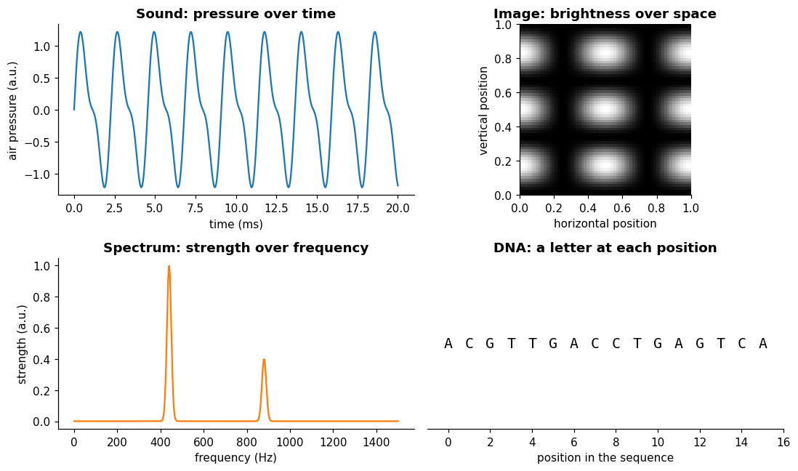

# Signals

**In one sentence:** a signal is something that changes, recorded as a function, so it can carry information about the thing that produced it.

- **Builds on:** nothing: a starting point.
- **Used by:** [Sampling](sampling.md), [Fourier transform](fourier-transform.md), [Time series](../time-series/time-series.md).

## What a signal is

A signal is "a function that conveys information about a phenomenon" ([Signal][signal]).

In plain words:

- something in the world **changes**: the air pressure near a speaker, the temperature of a room, the voltage in a wire;
- we **measure** it, and write down how it changes;
- that record is the signal: **input** "where or when" → **output** "how much".

"Any quantity that can vary over space or time can be used as a signal" ([Signal][signal]).

- The "where or when" part is the signal's **independent variable**.
- The set of values it can take is the signal's **domain**: the domain of a function is "the set of inputs accepted by the function" ([Domain of a function][domain]).
- The "how much" part is its **value**.

The four examples above have something in common: each one maps an input (time, a position in an image, a frequency, a position in a DNA sequence) to a value.

## Kinds of signals

Signals can be grouped in several ways. Two questions sort most of them.

### What produced it

| Kind | Examples |
|---|---|
| **Physical** | sound (air pressure), temperature, voltage and current, light |
| **Biological** | heartbeat (ECG), brain activity (EEG): "a biosignal is any signal in a living organism that can be continually measured" ([Signal][signal]) |
| **Industrial** | the sensors and actuators of a plant: flow, level, pressure, valve positions |
| **Images and video** | an image is brightness as a function of position; a video is "a sequence of images" ([Signal][signal]) |
| **Symbolic** | a DNA sequence (one letter out of four at each position), the letters of a text |

### What it is a function of: its domain

| Domain | The input is… | Example |
|---|---|---|
| **Time** | a moment | a sound, a temperature over the day |
| **Space** | a position | an image (2D), a scan of a terrain |
| **Frequency** | a rate of repetition | a spectrum: how strong each frequency is in a sound |
| **Sequence position** | an index in an ordered list | DNA: which letter is at position 1, 2, 3… |

**The same thing can be seen in more than one domain.** The sound and the spectrum in the figure above are two views of the same tone:

- the first says how the pressure changes over time;
- the second how strong each frequency is (440 Hz and 880 Hz).

The full spectrum gives each frequency both a strength and a **phase** (where the wave starts). With both, it holds the same information as the sound, and the sound can be rebuilt from it: "the phase portion is required to uniquely define the signal" ([Frequency domain][freq]).

The figure shows only the strengths, so it holds less. The two views make different things easy to see.

## Time-based vs not time-based

A signal is **time-based** when its independent variable is time. Many useful signals aren't.

| | Time-based | Not time-based |
|---|---|---|
| **Independent variable** | time | space, frequency, position in a sequence |
| **Examples** | sound, temperature, a plant's sensors | an image, a spectrum, a DNA sequence |
| **Has a past and a future?** | **yes:** the past comes before the future | **no:** left and right in an image are equivalent; a DNA sequence has an order, but no past and future |
| **What you can know** | while it is recorded, only the past; once recorded, all of it | the whole signal at once |

The key difference is **direction**:

- **Time flows one way.** At any moment you know the past, never the future.
  - A model that predicts what comes next must only use what came before: it must be **causal**. A causal system is one "where the output depends on past and current inputs but not future inputs"; one that also uses future values is non-causal ([Causal system][causal]).
  - When predicting what comes next, using later values, even by accident, is cheating, and it makes results look better than they are.
  - Working in real time also requires it: real-time systems "must be causal because such systems cannot act on a future input" ([Causal filter][causalfilter]).
- **Not every task predicts what comes next.** Filling a gap, or judging a stretch of a recording after the fact, may legitimately use values on both sides of it.
  - For example, a moving average centered on each step uses later values: it is non-causal, which is fine when the whole recording is already available ([Causal filter][causalfilter]).
  - [Imputation](../time-series/tasks/imputation.md) is such a task.
- **Space has no past and future.** An image can be read left to right or right to left. Every pixel is available at once.

Some non-time signals still have a natural **order**. DNA has no "past" and "future", but its letters come in a fixed sequence, and that sequence has a direction: a DNA strand has a 5′ end and a 3′ end, and sequences are written from 5′ to 3′ by convention ([Directionality][direction]). Every position is still known at once.

Ordered signals like these can be treated with the same tools as time-based ones, which is the idea behind [time series](../time-series/time-series.md).

## Key points

- A **signal** is a function: "where or when" → "how much".
- Its **independent variable** is what it's a function of: time, space, frequency, or position in a sequence; its **domain** is the set of values that variable can take. The same thing can be viewed in more than one domain.
- **Time-based** signals have a past and a future: a model that predicts what comes next must be **causal**, using only what came before. Tasks that don't predict what comes next, such as filling a gap, may use values on both sides.

## Sources

- [Signal (Wikipedia)][signal]: definition, kinds of signals. Read on 2026-11-08.
- [Causal system (Wikipedia)][causal]: causal and non-causal systems. Read on 2026-11-09.
- [Causal filter (Wikipedia)][causalfilter]: real-time systems must be causal; a centered moving average is non-causal. Read on 2026-11-09.
- [Domain of a function (Wikipedia)][domain]: the domain as the set of inputs. Read on 2026-11-09.
- [Frequency domain (Wikipedia)][freq]: magnitude and phase of a spectrum. Read on 2026-11-09.
- [Directionality (molecular biology) (Wikipedia)][direction]: the 5′ and 3′ ends of a DNA strand. Read on 2026-11-09.

[signal]: https://en.wikipedia.org/wiki/Signal
[causal]: https://en.wikipedia.org/wiki/Causal_system
[causalfilter]: https://en.wikipedia.org/wiki/Causal_filter
[domain]: https://en.wikipedia.org/wiki/Domain_of_a_function
[freq]: https://en.wikipedia.org/wiki/Frequency_domain
[direction]: https://en.wikipedia.org/wiki/Directionality_(molecular_biology)
