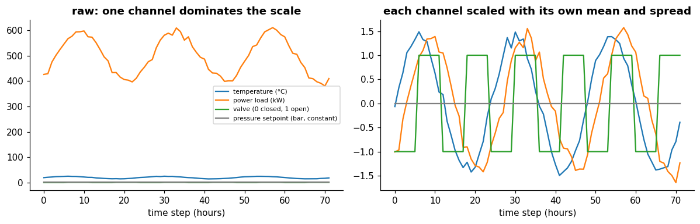
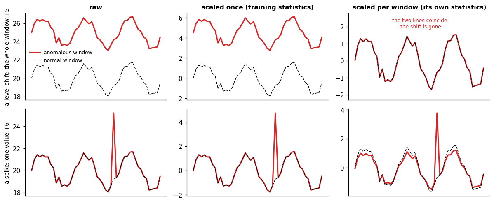
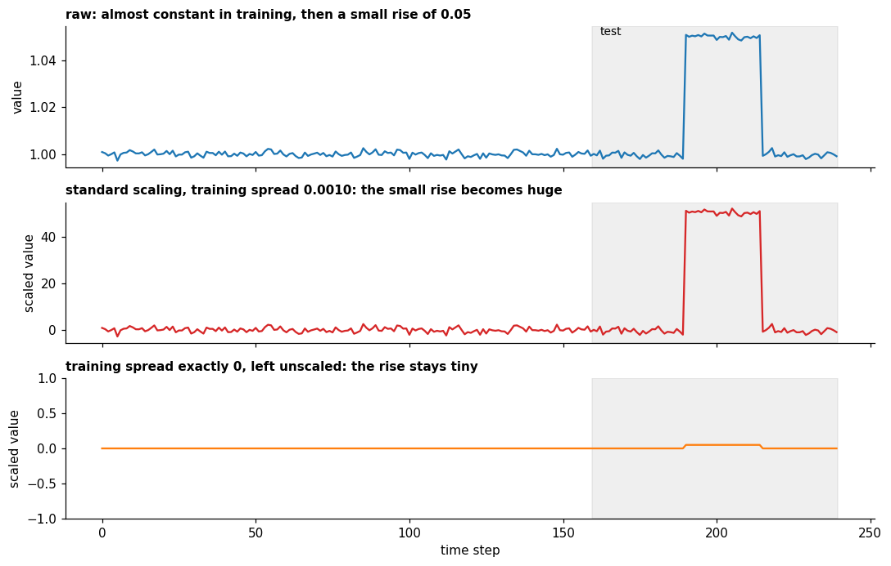

# Normalization in time series

**In one sentence:** a multivariate series is normalized channel by channel, either once with statistics from the training data or again for every window, and binary or constant channels need care, especially in anomaly detection.

- **Builds on:** [Normalization](../../data-preparation/normalization.md), [Time series](../time-series.md), [Stationarity](../structure/stationarity.md), [Splitting](splitting.md), [Kinds of anomalies](../../anomaly-detection/kinds-of-anomalies.md).
- **Used by:** [Forecast evaluation](../evaluation/forecast-evaluation.md), [Forecasting models](../models/forecasting-models.md), [Responding to drift](../../drift/responding-to-drift.md).

The methods themselves (standard, min-max and robust scaling) and their effects are explained in [normalization](../../data-preparation/normalization.md). This doc covers what is specific to time series.

## Per channel

In a [multivariate](../time-series.md#univariate-and-multivariate) series, each channel is a feature with its own units and range. Each channel is normalized with its **own** statistics: the mean and spread of the temperature, the mean and spread of the power load, and so on.

- **Raw (left):** the power load, in the hundreds, squeezes the temperature, the valve and the setpoint into a flat line.
- **Scaled (right):** all four channels are comparable. The valve takes two values, and the constant setpoint stays at 0 ([constant channels](#constant-channels)).

## Once, or for every window

There are two ways to apply it.

- **Once, globally:** compute the statistics on the training data, then apply the same transformation to every window, in training and at test time ([splitting](splitting.md)).
- **Again for every window:** each input window is normalized with its own mean and spread, per channel, and the model's output is transformed back with the same statistics ([wang2026deep](../../../literature/wang2026deep.md), p. 3). Many deep models do this, for example with RevIN (reversible instance normalization), and so do several time-series foundation models, which z-normalize each context window ([anon2026when](../../../literature/anon2026when.md), p. 15).

The difference is what each window keeps:

| | Once (global) | Per window |
|---|---|---|
| **What the window keeps** | its level and spread, compared with the training data | only its shape |
| **Pros** | a window higher, or more variable, than usual still looks different | robust to drift: a slowly moving level or spread disappears |
| **Cons** | after drift, the training statistics no longer fit: normal windows look abnormal, and values can fall outside the range seen in training | a window that is entirely shifted, or uniformly more variable, looks normal |
| **Best fit** | stable series, where the level itself matters | series that drift, where the shape matters |

Per-window normalization "takes the role of stationarization", and "helps mitigate the distribution shift between the source and target domains" ([wang2026deep](../../../literature/wang2026deep.md), p. 3; [stationarity](../structure/stationarity.md)). Removing too much is called over-stationarization; one model adds a dedicated attention mechanism against it ([wang2026deep](../../../literature/wang2026deep.md), p. 9).

### In anomaly detection

Neither is better in general: it depends on the [kind of anomaly](../../anomaly-detection/kinds-of-anomalies.md).

- **A level shift** (top): scaled once, the anomalous window stays far above the normal one. Scaled per window, the two coincide: the shift is gone.
- **A spike** (bottom): visible either way, because it changes the shape inside the window.

So per-window normalization misses anomalies that change a whole window's level or spread, and once-only normalization raises false alarms when the normal level drifts.

Per-window normalization can also turn into a shortcut: with it, one study finds that a reconstruction model's anomaly score is roughly the window's variance times a near-constant error ([anon2026when](../../../literature/anon2026when.md), p. 6). The model then finds anomalies that raise the variance, and fails on low-variance ones (p. 5).

### Normalization or the learning method?

Per-window normalization is one way to handle drift; changing the model is another. They cover different parts of a drift ([lu2018learning](../../../literature/lu2018learning.md), p. 3):

- **The inputs change** ("virtual drift"): the values move, but the learned relationship still holds; it "does not affect the decision boundary".
- **The relationship changes** ("actual drift"): the same input now means, or is followed by, something else; it "will cause decision boundary change".
- In practice the two often occur together.

| | At the input: per-window normalization | In the learning method: retraining, fine-tuning, merging |
|---|---|---|
| **Handles** | only part of the input change: shifts in level and spread | any change, including the relationship and the shape of the patterns |
| **How** | a fixed formula per window, no learning | the weights change, using data from the new period |
| **Cost** | free and immediate, from the first window after the drift | needs new data and training; may forget earlier periods |
| **Loses** | each window's level and spread | nothing at the input |

They are not alternatives: normalization removes the simple part of a drift before the model sees it, and the learning method has to handle the rest. So with per-window normalization, a learning method meets less drift than the raw data contain. More on adapting the model: [responding to drift](../../drift/responding-to-drift.md).

## Binary channels

Many plants have channels that are on or off: a pump running or not, a valve that is opened or closed, as in the stages of the SWaT (Secure Water Treatment) testbed ([mathur2016swat](../../../literature/mathur2016swat.md), p. 2).

They don't need to be excluded, but scaling them adds nothing:

- **Min-max scaling** keeps them as 0 and 1: the same as leaving them out.
- **Standard scaling** maps them to two other values. If one state is rare, it gets a large value: a valve open 5% of the time becomes about $+4.4$ when open, far beyond the usual range of a continuous channel. In anomaly detection this cuts both ways: a valve that opens for the first time stands out, but so does every normal, rare opening.
- **Per-window normalization** changes their meaning from window to window. In a window where the valve never moves, the channel is constant and becomes all zeros; in a window with one switch, the two states get values set by how long each lasted. The same "open" becomes a different number in different windows.

One way to see it: a binary channel's scale is already meaningful, so leave it as 0 and 1 and scale only the continuous channels.

## Constant channels

A channel that never changes in the training data has a spread of 0, and standard or min-max scaling would divide by zero ([normalization](../../data-preparation/normalization.md#constant-and-binary-features)).

Common ways to handle it:

- **leave it unscaled:** scikit-learn keeps the scale at 1 when the variance is zero ([StandardScaler][sk-standard]);
- **add a small constant** to the spread before dividing, as per-window normalization does for numerical stability ([wang2026deep](../../../literature/wang2026deep.md), p. 3);
- **drop the channel,** if it carries no information.

## In anomaly detection: when a constant channel moves

A channel that was constant during training and changes at test time is a special case: the change itself may be the anomaly. "Something that never moves just moved" can be the clearest sign that something is wrong, for example a setpoint changed by hand, or a valve stuck in a new position.

How it shows up depends on how the channel was scaled:

- **Tiny training spread** (sensor noise around a constant): dividing by it turns a small change into a huge value, about 50 here. The anomaly is impossible to miss, but the value can swamp every other channel, or overflow a model.
- **Spread exactly 0, left unscaled:** the change stays as small as it was, 0.05, next to channels scaled to a spread of 1. The anomaly can go unnoticed.

So neither default is safe on its own. One way out is to treat them separately:

1. **Find them on the training data:** the channels whose spread is 0, or below a small tolerance (sensor noise around a constant).
2. **Keep them out of the model:** in training they carry no information, so the model loses nothing.
3. **Watch them with a simple rule:** at test time, flag every step where such a channel moves away from its training value by more than the tolerance.
4. **Combine the two alarms:** report an anomaly when the model's score crosses its threshold, or when the rule fires.

The rule catches "something that never moves just moved" exactly, and the model is no longer distorted by a channel it could not scale.

## Key points

- Normalize a multivariate series **per channel**, each with its own statistics, learned on the training data.
- **Once (global)** keeps each window's level and spread, but suffers from drift; **per window** (e.g. RevIN, z-normalized context windows) is robust to drift, but hides anomalies that change a whole window's level or spread. Shape anomalies, such as a spike, show either way.
- **Per-window normalization vs the learning method:** normalization removes shifts in level and spread; changes in the relationship are left to the model.
- **Binary channels:** leave them as 0 and 1; standard scaling exaggerates a rare state, and per-window normalization changes their meaning from window to window.
- **Constant channels:** their spread is 0; leave them unscaled, add a small constant, or drop them.
- **In anomaly detection,** a constant channel that moves can be the anomaly: scaling may blow the change up or hide it, so keep such channels out of the model and flag any change in them with a simple rule.

## Sources

- [wang2026deep](../../../literature/wang2026deep.md): per-channel normalization of each input, transformed back on the output; normalization as stationarization; the small constant for stability.
- [anon2026when](../../../literature/anon2026when.md): foundation models z-normalize each context window; the effect on an anomaly score.
- [mathur2016swat](../../../literature/mathur2016swat.md): valves opened and closed in an industrial plant.
- [lu2018learning](../../../literature/lu2018learning.md): virtual and actual drift.
- scikit-learn, [StandardScaler][sk-standard]: constant features left as-is. Read on 2026-11-10.

[sk-standard]: https://scikit-learn.org/stable/modules/generated/sklearn.preprocessing.StandardScaler.html
