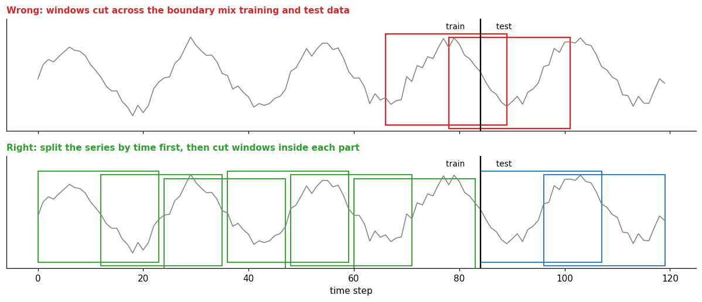
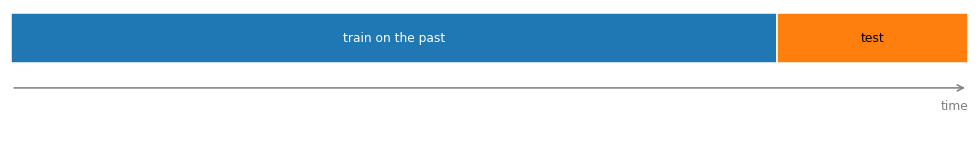
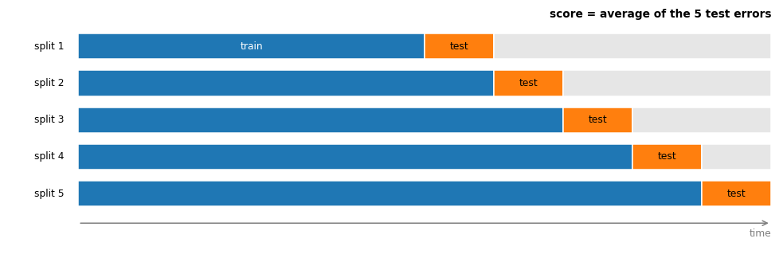
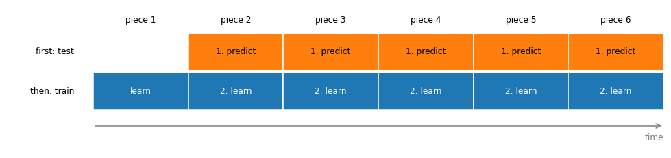
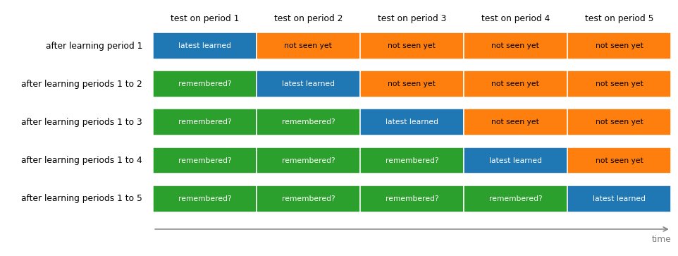
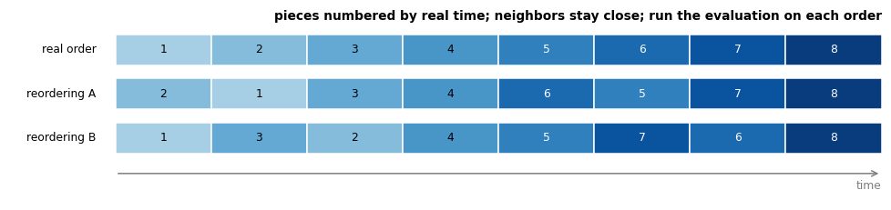
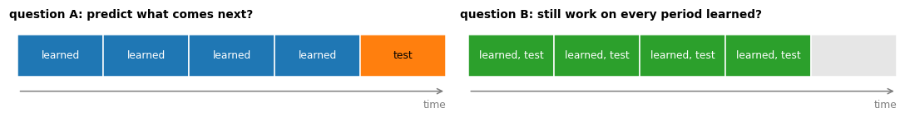

# Splitting

**In one sentence:** a series is split by time into a training part and later evaluation parts, and nothing from the later parts may reach training: not a window, not a statistic.

- **Builds on:**
  - [Time series](../time-series.md)
  - [Forecasting](../tasks/forecasting.md)
  - [Anomaly detection in time series](../tasks/anomaly-detection.md)
  - [Windows](windows.md)
  - [Responding to drift](../../drift/responding-to-drift.md)
  - [Transfer matrix](../../learning/continual-learning/transfer-matrix.md)
- **Used by:** [Normalization in time series](normalization.md).

## The rule not to break

A model is trained on one part of the data and evaluated on another it has never seen. With time series, the evaluation part must come **after** the training part, and the training windows must respect that boundary.

- **No training window may contain test-period steps.** A window that crosses the boundary contains test data; if it's used for training, the model has seen part of the test.
  - The simplest way to guarantee it: split by time first, then cut windows inside each part, as in the figure.
  - The rule binds training only. A test window may reach back into earlier steps as context, since past values are available when the model is used.
- **Never split windows at random.** With overlapping windows, almost every test window would have a near-identical twin in training: the model would look excellent and be useless on new data.
- **Compute anything learned from the data on the training part only,** e.g. the mean and spread used to scale the values ([normalization](normalization.md)). Using the whole series leaks information about the test period.

These mistakes, called **leakage**, raise no warning and don't crash anything. They silently make results look better than they are, which is why they're worth knowing before any experiment.

## What a chronological split favors

Splitting by time means the model is trained on the past and tested on what follows. When the series drifts, this favors methods that lean on the most recent data, such as retraining on a recent window or fine-tuning on each new piece in turn ([responding to drift](../../drift/responding-to-drift.md)): the test period comes right after the data they rely on most.

That isn't a flaw of the split. A deployed model also predicts the future, right after its most recent data, so for the question "how well does it predict what comes next?", the chronological split is the honest test.

The bias is in what a single split can't see:

- **one sample:** a single test period depends on where the split falls and on what the drift happens to do there;
- **only the next period:** it says nothing about the older periods. A method that forgot them looks fine until an old regime returns: recurring drift, a yearly season, a machine going back to an old setting.

### Mitigations

The mitigations don't remove the advantage of recent data: that advantage is real, and every scheme that looks forward keeps it. They solve two other problems:

- **Reliability:** one test period is a single measurement. Move the split a little, and the ranking of two methods can flip. Schemes 2, 3 and 5 average over many measurements, so the answer to the same question becomes more trustworthy.
- **Scope:** some questions can't be answered by a test period in the future, such as "does the method still work on old regimes?". Scheme 4 answers it, and shows the price of leaning on recent data: forgetting.

**1. One split.** Train on the past, test once on what follows. Honest about predicting the next period, but it's one measurement, and it ignores the older periods.

**2. Rolling origin (time-series cross-validation).** Move the split forward several times. Each time, train on everything before the split and test on the stretch right after it; then average the errors.

- "The corresponding training set consists only of observations that occurred prior to the observation that forms the test set", and "the forecast accuracy is computed by averaging over the test sets" ([FPP3, 5.10][fpp-tscv]).
- **Solves reliability:** the result no longer depends on one lucky or unlucky test period.
- **Costs:** the model is trained again for every split.

**3. Prequential evaluation.** The data arrive piece by piece, say one day at a time, and one model keeps learning:

1. a new day arrives: the current model first **predicts** it, and the error is recorded;
2. then the model **learns** from that day;
3. the next day arrives, and the same two steps repeat;
4. the final score is the average of all the recorded errors.

- Every day is predicted **before** the model has seen it, so nothing leaks, yet every day is also used for training afterwards: it "makes maximum use of the available data", with "no need to know the drift time of concepts" ([lu2018learning](../../../literature/lu2018learning.md), p. 12).
- It's how a deployed model that keeps learning works: predict, see what happened, update.
- **Differs from rolling origin:** rolling origin trains again from scratch for each split; prequential keeps updating one model.
- **Solves reliability**; like scheme 2, it still looks only forward, so it doesn't show forgetting.

**4. Test on every period.** Split the series into periods, and split each period into a training part and a held-out test part. The model learns period after period, from the training parts only. After each period, it is scored on the **test part of every period**: the ones it learned before, the one it just learned, and the ones it hasn't seen yet.

- **Earlier periods (green):** does the model still work on them after learning newer ones? A drop is forgetting, summarized by backward transfer ([forward and backward transfer](../../learning/continual-learning/forward-and-backward-transfer.md)).
- **Later periods (orange):** how well does it do on periods it hasn't seen yet?
- The scores form the [transfer matrix](../../learning/continual-learning/transfer-matrix.md).
- **Solves scope:** it measures what the other schemes can't, whether old regimes still work.
- **Costs:** one evaluation per period, after every training step.

**5. Controlled permutation.** Prequential evaluation depends on the one order in which the data happened to arrive. This scheme builds a few other orders, swapping only pieces that are close in time, runs the evaluation on each, and compares the results.

- It "reduces the risk that their prequential evaluation may produce biased results for the fixed order of data in a sequence" ([lu2018learning](../../../literature/lu2018learning.md), p. 12).
- **Solves reliability:** a result that holds across orders doesn't depend on one accident of timing.

**6. State the question.** The same trained model can be asked two different questions, and a method can win one and lose the other:

- **Question A, "predict what comes next?"**, is answered by schemes 1, 2, 3 and 5.
- **Question B, "still work on every period learned?"**, is answered by scheme 4.

Say which question each result answers, so a win on one isn't read as a win on the other.

## Key points

- **No training window may contain test-period steps:** split by time first, then cut windows; test windows may still use earlier steps as context.
- **Never split windows at random:** overlapping windows would put near-copies of test windows in training.
- **Learn scaling statistics on the training part only.**
- These mistakes (**leakage**) raise no warning or crash; they silently inflate results.
- Under drift, a chronological split **favors methods that rely on recent data**. It's the honest test of predicting what comes next, but one split is one sample and ignores older periods: use a **rolling origin** or **prequential** evaluation, test on **every period**, and say which question a result answers.

## Sources

- The splitting rules are general practice; the figure illustrates them on synthetic data.
- Hyndman, R. J., & Athanasopoulos, G., *Forecasting: Principles and Practice*, 3rd edition, OTexts, [Section 5.10, Time series cross-validation][fpp-tscv]: the rolling forecasting origin. Read on 2026-11-10.
- [lu2018learning](../../../literature/lu2018learning.md): prequential evaluation and controlled permutation.

[fpp-tscv]: https://otexts.com/fpp3/toolbox.html#sec-tscv
