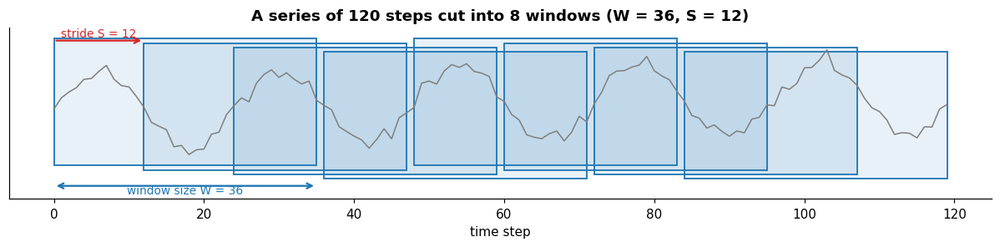
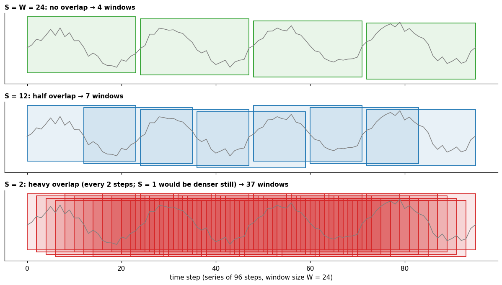
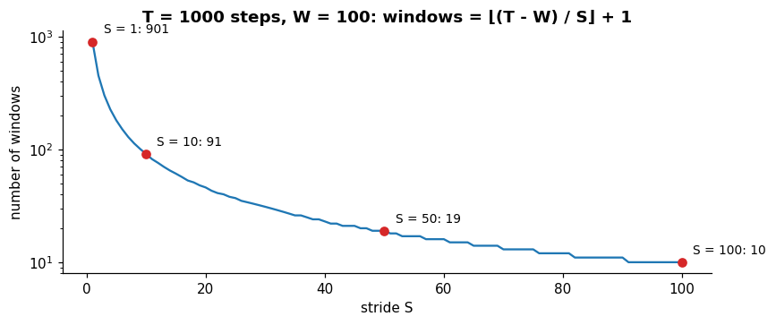
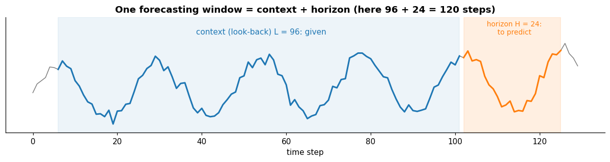

# Windows

**In one sentence:** models don't read a whole time series at once; they read short, fixed-length pieces of it, called windows, cut by sliding along the series.

- **Builds on:**
  - [Time series](../time-series.md)
  - [Patterns](../structure/patterns.md)
  - [Autocorrelation](../structure/autocorrelation.md)
  - [Tasks](../tasks/tasks.md)
  - [Forecasting](../tasks/forecasting.md)
  - [Anomaly detection in time series](../tasks/anomaly-detection.md)
- **Used by:** [Splitting](splitting.md).

## Why cut a series into windows

A real series can be very long: the SWaT training set alone has 396,000 steps ([wu2023timesnet](../../../literature/wu2023timesnet.md), Table 6, p. 14). Feeding it whole to a model doesn't work, for four reasons:

1. **Models expect a fixed input size.** Many models are built for inputs of one size, e.g. 96 steps × 7 channels.
2. **Memory and compute.** The cost of processing an input grows with its length; hundreds of thousands of steps at once don't fit on a GPU.
3. **Learning needs many examples.** One long series is one example; cut into windows, it becomes thousands of examples the model can learn from.
4. **What matters is usually local.** To predict the next hour, the last few days matter far more than last year.

So the series is cut into **windows**: short pieces of equal length.

## The two parameters: window size and stride

A window is cut, then the cutting point slides forward, again and again, until the series ends. Two numbers control it:

| Parameter | Symbol | Meaning |
|---|---|---|
| **Window size** (window length) | $W$ | how many steps each window contains |
| **Stride** (step) | $S$ | how many steps the window moves forward each time |

The first window covers the first $W$ steps; the next starts $S$ steps later; and so on, as long as a whole window still fits. A series of $T$ steps gives

$$\text{number of windows} = \left\lfloor \frac{T - W}{S} \right\rfloor + 1$$

where $\lfloor \cdot \rfloor$ means rounding down. In the figure: $\lfloor (120 - 36) / 12 \rfloor + 1 = 8$.

If $T - W$ isn't a multiple of $S$, the last few steps don't fill a window and are left out (or padded, depending on the code). It's a small loss, but worth knowing.

## Stride and overlap

The stride decides how much consecutive windows share:

- two consecutive windows share $W - S$ steps;
- $S = W$: **no overlap**, the windows sit side by side;
- $S < W$: **overlap**, each window repeats part of the previous one;
- $S = 1$: **maximal overlap**, consecutive windows differ by a single step.

A smaller stride gives many more windows, quickly:

## What each choice costs

Neither parameter has a "correct" value: each choice trades one thing for another.

### Window size $W$

| | Larger window | Smaller window |
|---|---|---|
| **What the model sees** | longer patterns: a daily pattern needs a window of at least one day | only short-term behavior |
| **Number of windows** | fewer (for the same stride) | more |
| **Cost per window** | higher: more memory and compute | lower |
| **Anomaly detection** | a short anomaly is a small part of a long window, and can be "diluted" | short anomalies stand out, but context is lost |

A useful rule of thumb: **the window must be at least as long as the slowest pattern you want the model to learn.** From the window alone, a model that sees 24 hourly steps can at best capture a daily pattern, not a weekly one (unless it is also given calendar features, such as the day of the week).

### Stride $S$

| | Small stride (lots of overlap) | Large stride (little or no overlap) |
|---|---|---|
| **Number of windows** | many | few |
| **How different they are** | nearly identical neighbors: at $S = 1$, two consecutive windows of 100 steps share 99 | separate pieces of the series; with $S > W$, the steps between windows are never seen |
| **Training cost per pass** | high: the same steps are processed many times | low |
| **Time resolution** | fine: a window starts at almost every step | coarse: something happening at a window's edge is cut in two |

**More windows isn't more information.** With a small stride, the number of windows grows, but they are heavily overlapping, shifted versions of each other: no new observations are added. The amount of data is the length of the series, not the number of windows.

The opposite extreme loses data: with a stride larger than the window ($S > W$), the steps between one window and the next fall in no window, and the model never sees them.

## Windows for forecasting

In forecasting, each window has two parts:

- the **context** (or look-back), length $L$: the part the model is given;
- the **horizon**, length $H$: the part it must predict.

So the window size is $W = L + H$. For each window, the model is given the context and its prediction is compared with the true horizon.

The sliding only cuts the windows. During training, they are usually shuffled and grouped into batches, not fed to the model in time order.

The common benchmark setting, used by the TSLib benchmark, is a **context of 96 steps** with **horizons of 96, 192, 336 and 720 steps** (on the small ILI dataset: context 36, horizons 24–60) ([wang2026deep](../../../literature/wang2026deep.md), p. 12).

The same paper notes that results depend strongly on the context length, and reruns its experiments searching over it ([wang2026deep](../../../literature/wang2026deep.md), pp. 12–13).

## Windows for anomaly detection

In anomaly detection there is no horizon: the model looks at a whole window and judges how normal it is. A common approach reconstructs the window and uses the reconstruction error as the anomaly score.

- TimesNet, for example, splits each dataset "into consecutive non-overlapping segments by sliding window", with windows of 100 steps ([wu2023timesnet](../../../literature/wu2023timesnet.md), p. 8; Table 6, p. 14).
- **Overlapping windows give each step several scores.** Reconstruction already gives an error per step, but a step can sit in more than one window.
  - With non-overlapping windows each step belongs to one window, so it gets one error.
  - With overlapping windows each step gets several errors, one per window that contains it, and they must be combined into one score, e.g. averaged.
  - The TimesNet paper states neither the stride used at training and test time nor how per-window errors map back to time steps ([wu2023timesnet](../../../literature/wu2023timesnet.md), "Not stated in the paper"; its pre-processing is described on p. 8). Any method that uses overlapping windows has to choose how to combine them, and should state it.

## Key points

- Models read **windows**: short, fixed-length pieces of a series.
- **Window size $W$:** how much the model sees at once. It must cover the slowest pattern of interest, and costs memory as it grows.
- **Stride $S$:** how far each window moves. Small strides give many, heavily overlapping windows: more examples, but not more information.
- Number of windows: $\lfloor (T - W)/S \rfloor + 1$.
- **Forecasting:** window = context + horizon, commonly 96 + {96, 192, 336, 720}.
- **Anomaly detection:** the whole window is reconstructed, e.g. 100 steps; with overlapping windows a step gets several errors, which must be combined into one score.

## Sources

- [wang2026deep](../../../literature/wang2026deep.md): standard forecasting context and horizon lengths, and the sensitivity to the context length.
- [wu2023timesnet](../../../literature/wu2023timesnet.md): non-overlapping windows of 100 steps for anomaly detection, and dataset sizes.
- The window count formula and the trade-offs are general practice; the figures illustrate them on synthetic data.
