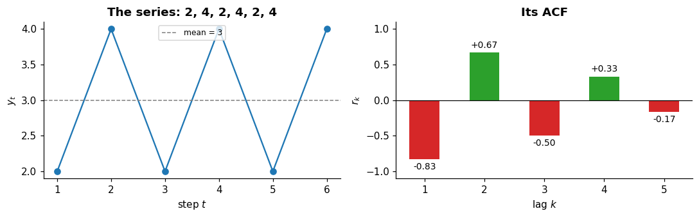

# Autocorrelation

**In one sentence:** autocorrelation measures how much a series resembles itself shifted in time, and the pattern it shows across shifts works as a fingerprint of the series.

- **Builds on:** [Patterns](patterns.md), [Stationarity](stationarity.md).
- **Used by:** [Windows](../data-preparation/windows.md).

## The idea

**Autocorrelation** measures how much a series resembles itself shifted in time ([FPP3, 2.8][fpp-acf]).

You compare each value with the one $k$ steps earlier. That distance $k$ is the **lag**:

- at lag 1, each value is compared with the one just before;
- at lag 24, in hourly data, with the one a day earlier.

The result is a number between $-1$ and $1$:

- **close to $+1$:** values $k$ steps apart move together (when one is high, so is the other);
- **close to $-1$:** they move in opposite directions;
- **close to $0$:** no (linear) relation.

Computing it for every lag gives the **ACF** (autocorrelation function): one value per lag ([FPP3, 2.8][fpp-acf]).

## A small example

Take six values that alternate: 2, 4, 2, 4, 2, 4. Their average is 3.

- **Lag 1:** each value is compared with the one before. They are always on opposite sides of the average (2 next to 4), so the autocorrelation is negative: $-0.83$.
- **Lag 2:** each value is compared with the one two steps before. They are always equal (2 with 2, 4 with 4), so it is positive: $+0.67$.
- **Lag 3:** opposite sides again: $-0.50$.

The pattern repeats every 2 steps, and the ACF shows it: positive at lags 2 and 4, negative in between. The values get smaller at larger lags only because fewer pairs fit in six values.

## What the ACF shows

The ACF works as a fingerprint of the series ([FPP3, 2.8][fpp-acf]; [FPP3, 2.9][fpp-wn]):

| The series has… | Its ACF shows… |
|---|---|
| a **seasonality** | peaks at the seasonal lags (and their multiples) |
| a **trend** | high values that decrease slowly as the lag grows |
| nothing but noise (**white noise**) | values close to zero at every lag |

Here, an hourly series with a daily pattern: the ACF peaks at lags 24, 48 and 72, one day, two days and three days apart.

## Why it matters

- **Time steps aren't independent.** In most real series, neighboring values are correlated; the ACF says how much ([time series](../time-series.md#what-makes-a-time-series-special)).
- **It finds patterns:** a seasonality shows up as peaks, at the period it repeats.
- **It tells whether a series is stationary:** for a [stationary](stationarity.md) series the ACF drops to zero quickly; a slowly decaying ACF is a sign of a trend ([FPP3, 9.1][fpp-stationarity]).
- **Models use it:** some forecasting models describe exactly these relations between a value and its past ([stationarity](stationarity.md#why-it-matters)).

## A closer look

### The formula

With $\bar{y}$ the average of the series and $T$ its length ([FPP3, 2.8][fpp-acf]):

$$r_k = \frac{\sum_{t=k+1}^{T} (y_t - \bar{y})(y_{t-k} - \bar{y})}{\sum_{t=1}^{T} (y_t - \bar{y})^2}$$

For every pair of values $k$ steps apart, it multiplies how far each is from the average: positive when both are on the same side, negative when on opposite sides. In the example, each value is 1 from the average: at lag 1 the 5 pairs give $-5$, divided by $6$ (six values, each $1^2$), so $r_1 = -5/6$.

### Autocorrelation and stationarity

The ACF describes a whole series only if the relation between two values depends on how far apart they are, not on when. That's what (weak) stationarity guarantees: the autocovariance doesn't change over time ([Stationary process][wiki]).

## Key points

- **Autocorrelation** compares a series with itself shifted by $k$ steps (the **lag**): $+1$ they move together, $-1$ opposite, $0$ no relation.
- The **ACF** (autocorrelation function) gives one value per lag.
- **Fingerprint:** peaks for seasonality, slow decay for a trend, near zero for white noise.
- It shows that time steps aren't independent, finds seasonal periods, and tells whether a series is stationary.

## Sources

- Hyndman, R. J., & Athanasopoulos, G., *Forecasting: Principles and Practice*, 3rd edition, OTexts, [Section 2.8, Autocorrelation][fpp-acf]: definition, formula, the ACF, seasonal and trend signatures. Read on 2026-11-09.
- Hyndman, R. J., & Athanasopoulos, G., *Forecasting: Principles and Practice*, 3rd edition, OTexts, [Section 2.9, White noise][fpp-wn]: white noise. Read on 2026-11-09.
- Hyndman, R. J., & Athanasopoulos, G., *Forecasting: Principles and Practice*, 3rd edition, OTexts, [Section 9.1, Stationarity and differencing][fpp-stationarity]: the ACF of stationary and non-stationary series. Read on 2026-11-09.
- [Stationary process (Wikipedia)][wiki]: weak stationarity. Read on 2026-11-09.

[fpp-acf]: https://otexts.com/fpp3/graphics.html#sec-acf
[fpp-wn]: https://otexts.com/fpp3/graphics.html#sec-wn
[fpp-stationarity]: https://otexts.com/fpp3/arima.html#sec-stationarity
[wiki]: https://en.wikipedia.org/wiki/Stationary_process
