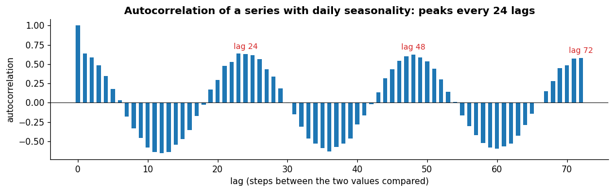

# Autocorrelation

**In one sentence:** autocorrelation measures how a series relates to its own past at each distance in steps, and works as a fingerprint of its patterns.

- **Builds on:** [Patterns](patterns.md), [Stationarity](stationarity.md).
- **Used by:** [Windows](../data-preparation/windows.md).

## How a series relates to its own past

**Autocorrelation** "measures the linear relationship between lagged values of a time series" ([FPP3, 2.8][fpp-acf]). The **lag** is the distance in steps between the two values being compared:

- at lag 1, each value is compared with the one just before;
- at lag 24, with the one a day earlier, in hourly data.

A plot of the autocorrelation at every lag works as a fingerprint of the series:

- **seasonality** shows up as peaks at the seasonal lags: "the autocorrelations will be larger for the seasonal lags (at multiples of the seasonal period) than for other lags" ([FPP3, 2.8][fpp-acf]);
- **a trend** shows up as values that "slowly decrease as the lags increase" ([FPP3, 2.8][fpp-acf]);
- **white noise** shows none: "time series that show no autocorrelation are called white noise"; its autocorrelations are all "close to zero", though "they will not be exactly equal to zero as there is some random variation" ([FPP3, 2.9][fpp-wn]).

In most real series, neighboring values are correlated, which is why time steps aren't independent samples ([time series](../time-series.md#what-makes-a-time-series-special)).
The autocorrelation measures how strongly, in the linear sense: an autocorrelation near zero means no linear relationship at that lag, as in white noise.

## Key points

- **Autocorrelation** compares a series with its own past at each lag: seasonal peaks, slow decay for trends, values close to zero for white noise.

## Sources

- Hyndman, R. J., & Athanasopoulos, G., *Forecasting: Principles and Practice*, 3rd edition, OTexts, [Section 2.8, Autocorrelation][fpp-acf]: autocorrelation, seasonal and trend signatures. Read on 2026-11-09.
- Hyndman, R. J., & Athanasopoulos, G., *Forecasting: Principles and Practice*, 3rd edition, OTexts, [Section 2.9, White noise][fpp-wn]: white noise. Read on 2026-11-09.

[fpp-acf]: https://otexts.com/fpp3/graphics.html#sec-acf
[fpp-wn]: https://otexts.com/fpp3/graphics.html#sec-wn
