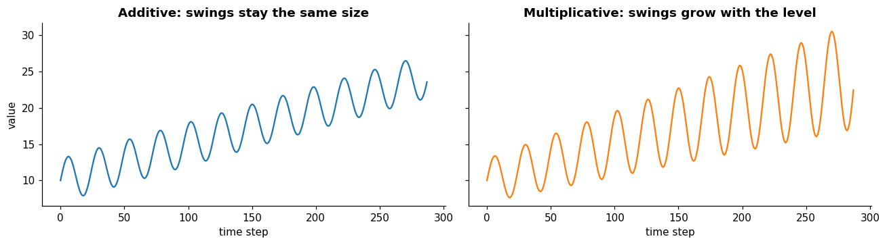
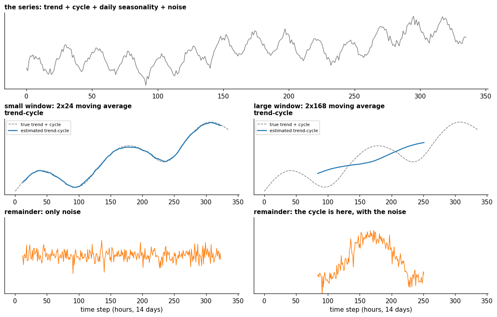

# Decomposition

**In one sentence:** decomposition takes a series apart into its trend-cycle, its seasonalities (one or more) and what's left, either by adding the parts or by multiplying them.

- **Builds on:** [Fourier transform](../../signals/fourier-transform.md), [Patterns](patterns.md).
- **Used by:** [Stationarity](stationarity.md).

## Taking a series apart

Splitting a series into its parts is called **decomposition**. There are two common ways to put the parts back together ([FPP3, 3.2][fpp-components]), with $y_t$ the series, $T_t$ the trend-cycle, $S_t$ the seasonality and $R_t$ the remainder:

| | Additive | Multiplicative |
|---|---|---|
| **Formula** | $y_t = S_t + T_t + R_t$ | $y_t = S_t \times T_t \times R_t$ |
| **Use it when** | the seasonal swings, and the variation around the trend-cycle, keep the same size whatever the level of the series | the seasonal swings, and the variation around the trend-cycle, grow in proportion to the level |

In the textbook's words ([FPP3, 3.2][fpp-components]):

- additive fits when "the magnitude of the seasonal fluctuations, or the variation around the trend-cycle, does not vary with the level of the time series";
- multiplicative fits when "the variation in the seasonal pattern, or the variation around the trend-cycle, appears to be proportional to the level of the time series";
- multiplicative decompositions "are common with economic time series".

Taking the logarithm turns a multiplicative series into an additive one, since $\log y_t = \log S_t + \log T_t + \log R_t$ ([FPP3, 3.2][fpp-components]).

### Several seasonalities

The formulas above have one seasonal part, but many series have more ([patterns](patterns.md#seasonality)). "Higher frequency time series often exhibit more complicated seasonal patterns. For example, daily data may have a weekly pattern as well as an annual pattern. Hourly data usually has three types of seasonality: a daily pattern, a weekly pattern, and an annual pattern" ([FPP3, 12.1][fpp-complex]).

A decomposition then has **one seasonal part per period**. In the additive case, for an hourly series with daily and weekly seasonality:

$$y_t = S^{\text{day}}_t + S^{\text{week}}_t + T_t + R_t$$

STL handles this directly: it "is designed to deal with multiple seasonality. It will return multiple seasonal components, as well as a trend and remainder component" ([FPP3, 12.1][fpp-complex]).

Decomposition is useful in itself, to see what drives a series.

It can also help the [tasks](../tasks/tasks.md), with a caveat on unusual values:

- a **robust** method such as [STL](#stl-in-brief) can be set so that "occasional unusual observations will not affect the estimates of the trend-cycle and seasonal components. They will, however, affect the remainder component" ([FPP3, 3.6][fpp-stl]): unusual values tend to show up in the remainder;
- the simpler [classical decomposition](#classical-decomposition) "is not robust to these kinds of unusual values" ([FPP3, 3.4][fpp-classical]): they can leak into the trend-cycle and seasonal estimates.

## Moving averages

A **moving average** replaces each value with the average of the values around it. Neighboring values tend to be close, so averaging them "eliminates some of the randomness in the data, leaving a smooth trend-cycle component" ([FPP3, 3.3][fpp-ma]).

A moving average of order $m$ (an **m-MA**), with $m = 2k + 1$ ([FPP3, 3.3][fpp-ma]):

$$\hat{T}_t = \frac{1}{m} \sum_{j=-k}^{k} y_{t+j}$$

The value at step $t$ is the average of the value at $t$ and of the $k$ values on each side. It can't be computed for the first $k$ and last $k$ steps.

## Trend or cycle? It depends on the smoothing

The trend-cycle isn't found by estimating a trend and a cycle separately and adding them. It is estimated directly, by **smoothing** the series, for example with a moving average:

- "The order of the moving average determines the smoothness of the trend-cycle estimate. In general, a larger order means a smoother curve" ([FPP3, 3.3][fpp-ma]).
- The result "captures the main movement of the time series without all of the minor fluctuations" ([FPP3, 3.3][fpp-ma]).

So the trend-cycle is **whatever slow movement survives the smoothing**, and the size of the smoothing window decides where the line falls:

- a **small window** lets the trend-cycle follow faster ups and downs, at the risk of also following noise;
- a **large window** keeps only the slowest movement; faster ups and downs are smoothed away.

[STL](#stl-in-brief), a common decomposition method, exposes this choice directly: its trend window controls "how rapidly the trend-cycle and seasonal components can change. Smaller values allow for more rapid changes" ([FPP3, 3.6][fpp-stl]).

- **Small window** (a 2x24 moving average, which also cancels the daily seasonality): the estimated trend-cycle follows the true trend and cycle, and the remainder is only noise.
- **Large window** (2x168, one week): the trend-cycle keeps only the slow rise; the cycle is smoothed away and ends up in the **remainder**, with the noise.
- The large window's curve is shorter: a moving average can't be computed within half a window of either end of the series.

### A fast cycle ends up in the remainder

A cycle faster than the smoothing window isn't captured by the trend-cycle. It can't be seasonality either, because it has no fixed period. So it lands in the remainder.

Fast irregular swings are rarely called cycles anyway: "the average length of cycles is longer than the length of a seasonal pattern" ([FPP3, 2.3][fpp-patterns]).

### Trend or cycle also depends on how much you see

The same movement can look like a trend over a short stretch and like part of a cycle over a long one: "if we had a much longer series, we would see that this downward trend is actually part of a long cycle, but when viewed over only 100 days it appears to be a trend" ([FPP3, 2.3][fpp-patterns]).

### One cycle or several?

A series can have irregular ups and downs at several scales at once, for example a long cycle and shorter swings. A decomposition doesn't name them one by one: it has a single trend-cycle, and the smoothing window decides which of them it keeps and which go to the remainder.

## Classical decomposition

"The classical decomposition method originated in the 1920s. It is a relatively simple procedure, and forms the starting point for most other methods of time series decomposition" ([FPP3, 3.4][fpp-classical]).

With $m$ the seasonal period, the additive version takes four steps ([FPP3, 3.4][fpp-classical]):

1. **Trend-cycle:** smooth the series with a [moving average](#moving-averages) spanning one seasonal period. Over a full period every season appears once, so the seasonal ups and downs cancel out and the trend-cycle remains.
   - If $m$ is odd, an m-MA does it.
   - If $m$ is even, an m-MA isn't centered on a step, so two of them are averaged: a **2×m-MA**, "equivalent to a weighted moving average of order m + 1 where all observations take the weight 1/m, except for the first and last terms which take weights 1/(2m)" ([FPP3, 3.3][fpp-ma]).
   - For example, "a 2×12-MA can be used to estimate the trend-cycle of monthly data with annual seasonality and a 7-MA can be used to estimate the trend-cycle of daily data with a weekly seasonality" ([FPP3, 3.3][fpp-ma]).
2. **Detrend:** subtract it, $y_t - \hat{T}_t$.
3. **Seasonality:** average the detrended values of each season; for example, "the seasonal component for March is the average of all the detrended March values in the data". Adjust these averages to add to zero, then repeat the same pattern for every year.
4. **Remainder:** what's left, $\hat{R}_t = y_t - \hat{T}_t - \hat{S}_t$.

The multiplicative version divides instead of subtracting.

FPP3 doesn't recommend it today: "While classical decomposition is still widely used, it is not recommended, as there are now several much better methods" ([FPP3, 3.4][fpp-classical]). Its problems:

- **Missing ends:** "The estimate of the trend-cycle is unavailable for the first few and last few observations", where the moving average can't be computed.
- **Over-smoothing:** it "tends to over-smooth rapid rises and falls in the data".
- **Fixed seasonality:** it assumes "the seasonal component repeats from year to year", so it can't follow a pattern that shifts, like electricity demand moving its peak from winter (heating) to summer (air conditioning).
- **Not robust:** it "is not robust to these kinds of unusual values".

[STL](#stl-in-brief) addresses each of these.

## STL in brief

**STL** is a widely used decomposition method. "STL is an acronym for 'Seasonal and Trend decomposition using Loess', while loess is a method for estimating nonlinear relationships" ([FPP3, 3.6][fpp-stl]). It "was developed by Cleveland et al. (1990), and later extended to handle multiple seasonal patterns by Bandara et al." ([FPP3, 3.6][fpp-stl]).

Its advantages over the simpler classical decomposition ([FPP3, 3.6][fpp-stl]):

- **any kind of seasonality:** it "will handle any type of seasonality, not only monthly and quarterly data", including several at once ([several seasonalities](#several-seasonalities));
- **seasonality can change:** "The seasonal component is allowed to change over time, and the rate of change can be controlled by the user";
- **adjustable smoothness:** "The smoothness of the trend-cycle can also be controlled by the user" ([trend or cycle](#trend-or-cycle-it-depends-on-the-smoothing));
- **a robust option:** unusual observations stay out of the trend-cycle and seasonal estimates, and show up in the remainder.

Its limits ([FPP3, 3.6][fpp-stl]):

- it "does not handle trading day or calendar variation automatically";
- it "only provides facilities for additive decompositions"; for a multiplicative one, take the logarithm of the data first, then back-transform the components.

## Where Fourier fits

**STL doesn't use Fourier.** It works in the **time domain**: it smooths the series locally with loess, a local regression that fits a simple curve to the nearby points ([Local regression][loess]).

**Why Fourier alone can't do STL's job:** the [Fourier transform](../../signals/fourier-transform.md) describes a series as waves of fixed frequency that last the whole series. Most of what a decomposition separates isn't like that:

- a **trend** isn't a wave at all, and a **cycle** has no fixed frequency: both blur together at the lowest frequencies, so the spectrum can't tell them apart;
- a **seasonality that changes over time** isn't one fixed set of frequencies, while STL lets it change;
- a **one-off unusual value** spreads over all frequencies, while STL can keep it in the remainder.

**Where Fourier is used:**

- **finding the seasonal periods** a decomposition needs as input: each one is a peak in the spectrum ([finding periods](../../signals/fourier-transform.md#finding-periods-in-a-time-based-signal));
- **modeling a seasonality** with sine and cosine terms, for example in a regression; useful for long periods and for several seasonalities at once ([FPP3, 7.4][fpp-fourier]; [FPP3, 12.1][fpp-complex]);
- **in deep time-series models,** as a building block: TimesNet finds a series' main periods with the FFT, and models such as Autoformer, FEDformer, FiLM and FITS work with chosen frequencies ([wang2026deep](../../../literature/wang2026deep.md), p. 5).

## Key points

- **Decomposition** takes a series apart: **additive** when swings stay the same size, **multiplicative** when they grow with the level.
- A series with **several seasonalities** (e.g. daily and weekly) gets **one seasonal part per period**.
- A **moving average** replaces each value with the average of its neighbors: it keeps the trend-cycle and drops the wiggles; over one full seasonal period it also cancels the seasonality.
- The **trend-cycle** is estimated by **smoothing**: whatever slow movement survives it. A larger window keeps only slower movements; faster cycles end up in the remainder.
- **Classical decomposition** (1920s): trend-cycle by moving average, seasonality by averaging each season; simple, but no longer recommended.
- **STL works in the time domain,** not with Fourier: trend, cycles, changing seasonality and one-off values aren't fixed-frequency waves. Fourier is used to find the seasonal periods, to model a seasonality, and inside deep time-series models.
- **STL** (Seasonal and Trend decomposition using Loess) is the usual method: any kind and number of seasonalities, adjustable smoothness, a robust option; additive only.
- With a robust decomposition, unusual values tend to show up in the remainder; classical decomposition isn't robust to them.

## Sources

- Hyndman, R. J., & Athanasopoulos, G., *Forecasting: Principles and Practice*, 3rd edition, OTexts, [Section 3.2, Time series components][fpp-components]: decomposition, additive and multiplicative, trend-cycle, remainder, the log transform. Read on 2026-11-09.
- Hyndman, R. J., & Athanasopoulos, G., *Forecasting: Principles and Practice*, 3rd edition, OTexts, [Section 3.4, Classical decomposition][fpp-classical]: its origin, the four steps, why it is no longer recommended. Read on 2026-11-09.
- Hyndman, R. J., & Athanasopoulos, G., *Forecasting: Principles and Practice*, 3rd edition, OTexts, [Section 3.6, STL decomposition][fpp-stl]: what STL is, its advantages and limits, robust decomposition, unusual values in the remainder, the trend window. Read on 2026-11-09.
- Hyndman, R. J., & Athanasopoulos, G., *Forecasting: Principles and Practice*, 3rd edition, OTexts, [Section 3.3, Moving averages][fpp-ma]: the m-MA formula, centering even orders, canceling seasonality, window size and smoothness. Read on 2026-11-09.
- Hyndman, R. J., & Athanasopoulos, G., *Forecasting: Principles and Practice*, 3rd edition, OTexts, [Section 2.3, Time series patterns][fpp-patterns]: the length of cycles; trend or cycle depending on how much is seen. Read on 2026-11-09.
- Hyndman, R. J., & Athanasopoulos, G., *Forecasting: Principles and Practice*, 3rd edition, OTexts, [Section 12.1, Complex seasonality][fpp-complex]: several seasonal patterns, STL with several seasonal components, Fourier terms for each seasonal period. Read on 2026-11-09.
- Hyndman, R. J., & Athanasopoulos, G., *Forecasting: Principles and Practice*, 3rd edition, OTexts, [Section 7.4, Some useful predictors][fpp-fourier]: Fourier terms for seasonality. Read on 2026-11-09.
- [Local regression (Wikipedia)][loess]: loess, the smoother STL uses. Read on 2026-11-09.
- [wang2026deep](../../../literature/wang2026deep.md): Fourier analysis as a building block of deep time-series models.

[fpp-components]: https://otexts.com/fpp3/decomposition.html#sec-components
[fpp-complex]: https://otexts.com/fpp3/advanced.html#sec-complexseasonality
[fpp-fourier]: https://otexts.com/fpp3/regression.html#sec-useful-predictors
[loess]: https://en.wikipedia.org/wiki/Local_regression
[fpp-ma]: https://otexts.com/fpp3/decomposition.html#sec-moving-averages
[fpp-patterns]: https://otexts.com/fpp3/graphics.html#sec-tspatterns
[fpp-classical]: https://otexts.com/fpp3/decomposition.html#sec-classical-decomposition
[fpp-stl]: https://otexts.com/fpp3/decomposition.html#sec-stl
