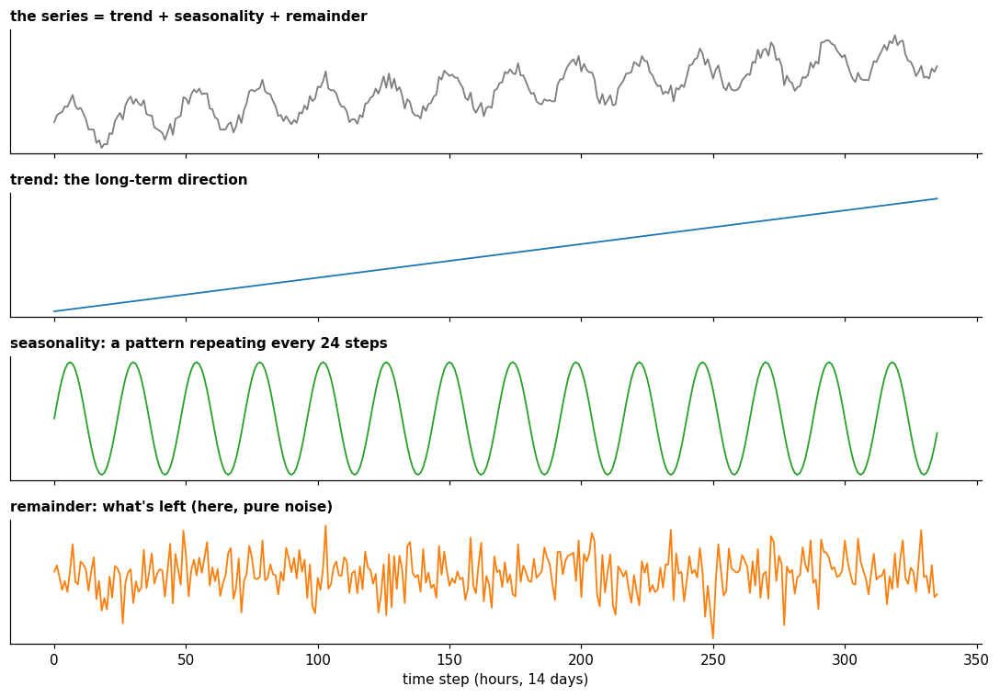
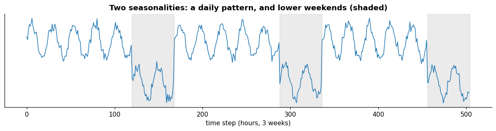
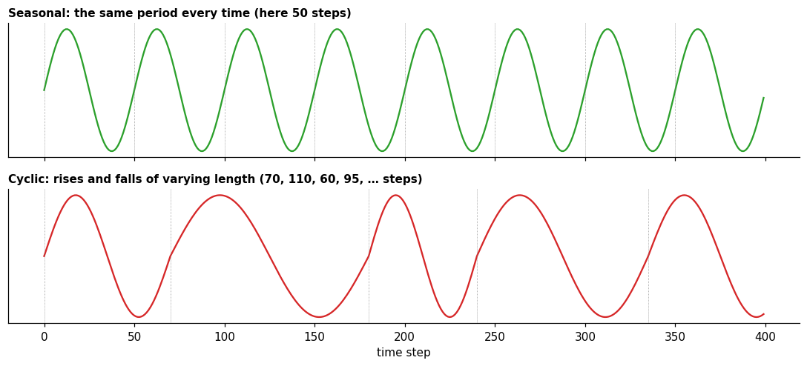

# Patterns

**In one sentence:** most time series are a mix of a few simple patterns (a long-term direction, regular repetitions, slower irregular waves, and a remainder with everything else), and recognizing them is the first step to understanding, predicting or checking a series.

- **Builds on:** [Fourier transform](../../signals/fourier-transform.md), [Time series](../time-series.md).
- **Used by:**
  - [Decomposition](decomposition.md)
  - [Stationarity](stationarity.md)
  - [Autocorrelation](autocorrelation.md)
  - [Tasks](../tasks/tasks.md)
  - [Anomaly detection](../tasks/anomaly-detection.md)
  - [Windows](../data-preparation/windows.md)

## The building blocks

Look at almost any real series (electricity use, temperature, sales) and you'll see the same few ingredients. The reference textbook on forecasting defines three patterns ([FPP3, 2.3][fpp-patterns]):

| Pattern | Definition | Example |
|---|---|---|
| **Trend** | "a long-term increase or decrease in the data" | a city's electricity use growing year after year |
| **Seasonality** | a pattern caused by "seasonal factors", "always of a fixed and known period" | higher electricity use every evening; lower every weekend |
| **Cycle** | "rises and falls that are not of a fixed frequency" | economic booms and recessions |

What's left after these is the **remainder** (also called residual): everything else, including noise and anything unusual.
In the textbook's words, the remainder contains "anything else in the time series" ([FPP3, chapter 3][fpp-decomposition]).

The figure shows a series built by adding its parts: the top panel is the sum, the kind of series you'd actually record.
The three panels below are the parts it was built from.
Going the other way, from a recorded series to its parts, is called [decomposition](decomposition.md).

## Seasonality

Seasonality means **repetition at a fixed, known period**. The word comes from the seasons of the year, but the period can be anything tied to a calendar or a clock:

- **daily:** busier during the day, quiet at night;
- **weekly:** different on weekends than on weekdays;
- **yearly:** heating in winter, cooling in summer.

The **period** is the number of steps before the pattern repeats: in an hourly series, daily seasonality has a period of 24 and a weekly one 168.

When the periods aren't known in advance, the series' spectrum shows them: each seasonal period appears as a peak ([Fourier transform](../../signals/fourier-transform.md#finding-periods-in-a-time-series)).

**A series can have more than one seasonality** at once: "one series can have more than one seasonal pattern" ([FPP3, 2.3][fpp-patterns]).

**Why it matters:** seasonality is the most predictable part of many series.

It also suggests how much history a model should see.
As a rule of thumb, a window should cover at least one full period of the slowest seasonality the model must learn from the window alone: a week, for a weekly pattern (see [windows](../data-preparation/windows.md)).
Models can also get the position in the day or week from calendar features, instead of from the window.

## Seasonality vs cycles

The two are easy to confuse, because both go up and down. The difference is **regularity**:

- "if the frequency is unchanging and associated with some aspect of the calendar, then the pattern is seasonal";
- "if the fluctuations are not of a fixed frequency then they are cyclic" ([FPP3, 2.3][fpp-patterns]).

Cycles are usually slower: in economic data their duration "is usually at least 2 years", and "the average length of cycles is longer than the length of a seasonal pattern" ([FPP3, 2.3][fpp-patterns]).

Because their length varies, cycles are harder to predict: "before we observe the series we cannot be sure where the peaks and troughs of the cycles will be" ([FPP3, 9.1][fpp-stationarity]).

When a series is taken apart, "we usually combine the trend and cycle into a single trend-cycle component (often just called the trend for simplicity)" ([FPP3, chapter 3][fpp-decomposition]).

## Key points

- Most series combine a **trend**, one or more **seasonalities**, **cycles** and a **remainder** (everything else, including noise and anything unusual).
- **Seasonality** repeats at a fixed, known period; **cycles** rise and fall irregularly and are usually slower.
- As a rule of thumb, a window should cover at least one full period of the slowest seasonality the model must learn from the window alone.

## Sources

- Hyndman, R. J., & Athanasopoulos, G., *Forecasting: Principles and Practice*, 3rd edition, OTexts, [Section 2.3, Time series patterns][fpp-patterns]: trend, seasonality, cycles. Read on 2026-11-09.
- Hyndman, R. J., & Athanasopoulos, G., *Forecasting: Principles and Practice*, 3rd edition, OTexts, [Chapter 3, Time series decomposition][fpp-decomposition] (introduction): the remainder, the trend-cycle. Read on 2026-11-09.
- Hyndman, R. J., & Athanasopoulos, G., *Forecasting: Principles and Practice*, 3rd edition, OTexts, [Section 9.1, Stationarity and differencing][fpp-stationarity]: why cycles are hard to predict. Read on 2026-11-09.

[fpp-patterns]: https://otexts.com/fpp3/graphics.html#sec-tspatterns
[fpp-decomposition]: https://otexts.com/fpp3/decomposition.html#sec-decomposition
[fpp-stationarity]: https://otexts.com/fpp3/arima.html#sec-stationarity
