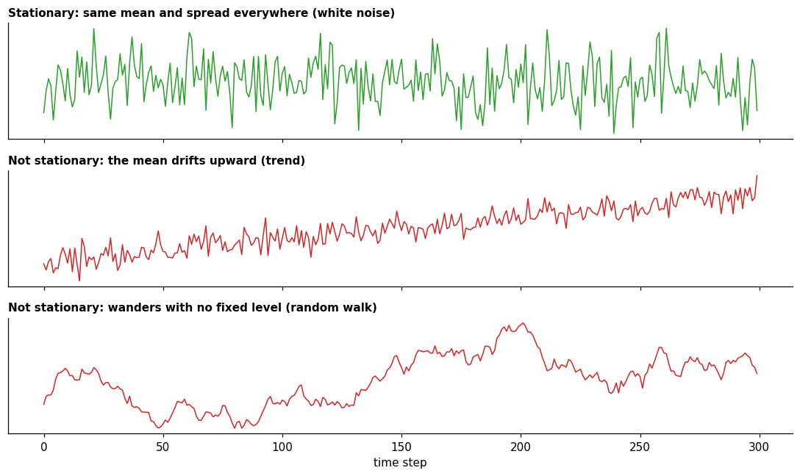

# Stationarity

**In one sentence:** a stationary series keeps the same statistical character over time, so its past is a good guide to its future; trends and seasonality break it.

- **Builds on:** [Patterns](patterns.md), [Decomposition](decomposition.md).
- **Used by:** [Autocorrelation](autocorrelation.md), [Drift in time series](../change-over-time/drift-in-time-series.md), [Distribution shift](../../change-over-time/distribution-shift.md).

## Does the series keep its character?

"A stationary time series is one whose statistical properties do not depend on the time at which the series is observed" ([FPP3, 9.1][fpp-stationarity]).

In plain words: any stretch of the series looks statistically like any other stretch, with the same average level and the same amount of variation.

- **Not stationary:** "time series with trends, or with seasonality, are not stationary" ([FPP3, 9.1][fpp-stationarity]): the trend moves the average, and the seasonality makes the expected value depend on the hour or the day.
- **Stationary:** "a white noise series is stationary" ([FPP3, 9.1][fpp-stationarity]).
- **Perhaps surprisingly,** a series with cycles but no trend or seasonality is stationary ([FPP3, 9.1][fpp-stationarity]). Our explanation: cycles have no fixed length, so no particular moment is expected to be high or low.

**Why it matters:** a model learns from the past and is used on the future.

- If the series keeps its character, the past is a good guide.
- If it doesn't, what was learned may stop being valid.

This is the situation called **drift** ([drift in time series](../change-over-time/drift-in-time-series.md), [distribution shift](../../change-over-time/distribution-shift.md)), and it is central to this project.

A common way to make a series more stationary is **differencing**: instead of the values, look at the changes between consecutive values. This can help stabilize the mean of a series by removing changes in its level ([FPP3, 9.1][fpp-stationarity]).

## Key points

- A **stationary** series keeps the same statistical character over time; trends and seasonality break it.
- When it breaks, past behavior stops being a reliable guide (**drift**).
- **Differencing** (looking at changes between consecutive values) can make a series more stationary.

## Sources

- Hyndman, R. J., & Athanasopoulos, G., *Forecasting: Principles and Practice*, 3rd edition, OTexts, [Section 9.1, Stationarity and differencing][fpp-stationarity]: stationarity, differencing. Read on 2026-11-08.

[fpp-stationarity]: https://otexts.com/fpp3/stationarity.html
