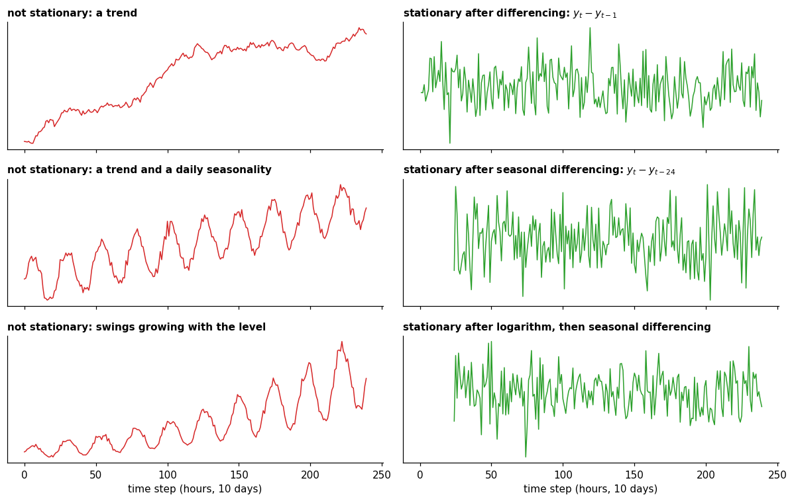

# Stationarity

**In one sentence:** a series is stationary when it looks the same, statistically, wherever you look at it: same average, same spread, same rhythm.

- **Builds on:** [Patterns](patterns.md), [Decomposition](decomposition.md).
- **Used by:**
  - [Distribution shift](../../drift/distribution-shift.md)
  - [Autocorrelation](autocorrelation.md)
  - [Forecasting](../tasks/forecasting.md)
  - [Normalization](../data-preparation/normalization.md)
  - [Drift in time series](../drift/drift-in-time-series.md)

## The idea

Take any stretch of a stationary series and compare it with any other stretch: the average level is the same, the spread is the same, and values relate to their neighbors in the same way. Nothing about it depends on *when* you look ([FPP3, 9.1][fpp-stationarity]).

- **Top, stationary:** random noise around a fixed level. Every stretch looks alike.
- **Middle, not stationary:** a trend. The average keeps rising, so early and late stretches differ.
- **Bottom, not stationary:** a random walk, where each value is the previous one plus a random step ([FPP3, 9.1][fpp-stationarity]). It wanders with no fixed level.

## Stationary or not?

| Stationary | Not stationary |
|---|---|
| random noise around a fixed level | a **trend**: the average moves |
| ups and downs of no fixed length around a fixed level (cycles) | a **seasonality**: the expected value depends on the hour, day or month |
| | **swings that grow or shrink** over time |
| | a **random walk** |

Most real series are **not** stationary: anything with a trend or a seasonality isn't ([FPP3, 9.1][fpp-stationarity]).

## How to tell

- **Look at the plot:** a stationary series stays roughly flat, with the same spread throughout.
- **Look at the autocorrelation:** for a stationary series it drops to zero quickly; for a non-stationary one it decreases slowly ([FPP3, 9.1][fpp-stationarity]; [below](#stationarity-and-autocorrelation)).
- **Use a test:** for example the KPSS (Kwiatkowski–Phillips–Schmidt–Shin) test, which checks whether the data are consistent with being stationary. Different tests can disagree ([FPP3, 9.1][fpp-stationarity]).

## How to make a series stationary

Transform it ([FPP3, 9.1][fpp-stationarity]):

- **Differencing:** use the changes between consecutive values instead of the values. This removes a trend.
- **Seasonal differencing:** subtract the value from one season earlier, e.g. this Monday minus last Monday. This removes a seasonality.
- **Logarithm:** makes swings that grow with the level the same size.

Each row goes from a non-stationary series (left) to a stationary one (right): flat, with an even spread. The series are synthetic.

## Why it matters

**Some models need it.** ARIMA (autoregressive integrated moving average) models describe how values relate to past values, so they need those relations to stay the same over time ([FPP3, chapter 9][fpp-arima]). They make the series stationary, forecast it, then transform the forecasts back: the "integrated" in the name means undoing the differencing ([FPP3, chapter 9][fpp-arima]).

**Others don't.** Exponential smoothing models the trend and the seasonality directly ([FPP3, chapter 9][fpp-arima]). Deep models rescale each input window, then learn the patterns themselves ([wang2026deep](../../../literature/wang2026deep.md), p. 3).

**So forecasting doesn't require stationarity.** What it requires is that the patterns continue:

- a steady trend or seasonality is not stationary, but it is predictable;
- an unexpected change in behavior, called **drift**, is the real problem, whatever the model ([drift in time series](../drift/drift-in-time-series.md), [distribution shift](../../drift/distribution-shift.md)).

Stationary doesn't mean predictable either: random noise is stationary, and it can't be predicted at all ([FPP3, 9.1][fpp-stationarity]).

## A closer look

### The formal definition

A process is **strictly stationary** when its whole probability distribution stays the same when shifted in time. In practice a weaker version is used, **weak stationarity**: the mean and the autocovariance don't change over time ([Stationary process][wiki]).

### Stationarity and autocorrelation

- In a stationary series, how two values relate depends only on how far apart they are (the lag), not on when. So one ACF (autocorrelation function) describes the whole series ([autocorrelation](autocorrelation.md)).
- That's also why the autocorrelation is a test: a slowly decaying ACF, or seasonal peaks in it, are signs of non-stationarity ([FPP3, 9.1][fpp-stationarity]).

## Key points

- **Stationary:** looks the same, statistically, wherever you look: same average, same spread, same rhythm.
- **Not stationary:** trends, seasonality, changing swings, random walks; most real series.
- **How to tell:** the plot, the autocorrelation, or a test.
- **How to fix it:** differencing, seasonal differencing, logarithm.
- **Forecasting doesn't need it:** some models transform the series, others model trend and seasonality directly; what matters is that the patterns continue. Unexpected change (drift) is the real problem.

## Sources

- Hyndman, R. J., & Athanasopoulos, G., *Forecasting: Principles and Practice*, 3rd edition, OTexts, [Section 9.1, Stationarity and differencing][fpp-stationarity]: definition, examples, how to tell, unit root tests, differencing, logarithms, the random walk. Read on 2026-11-09.
- Hyndman, R. J., & Athanasopoulos, G., *Forecasting: Principles and Practice*, 3rd edition, OTexts, [Chapter 9, ARIMA models][fpp-arima]: what ARIMA models describe and what "integrated" means; exponential smoothing. Read on 2026-11-09.
- [Stationary process (Wikipedia)][wiki]: strict and weak stationarity. Read on 2026-11-09.
- [wang2026deep](../../../literature/wang2026deep.md): normalization in deep models.

[fpp-stationarity]: https://otexts.com/fpp3/arima.html#sec-stationarity
[fpp-arima]: https://otexts.com/fpp3/arima.html#sec-arima
[wiki]: https://en.wikipedia.org/wiki/Stationary_process
