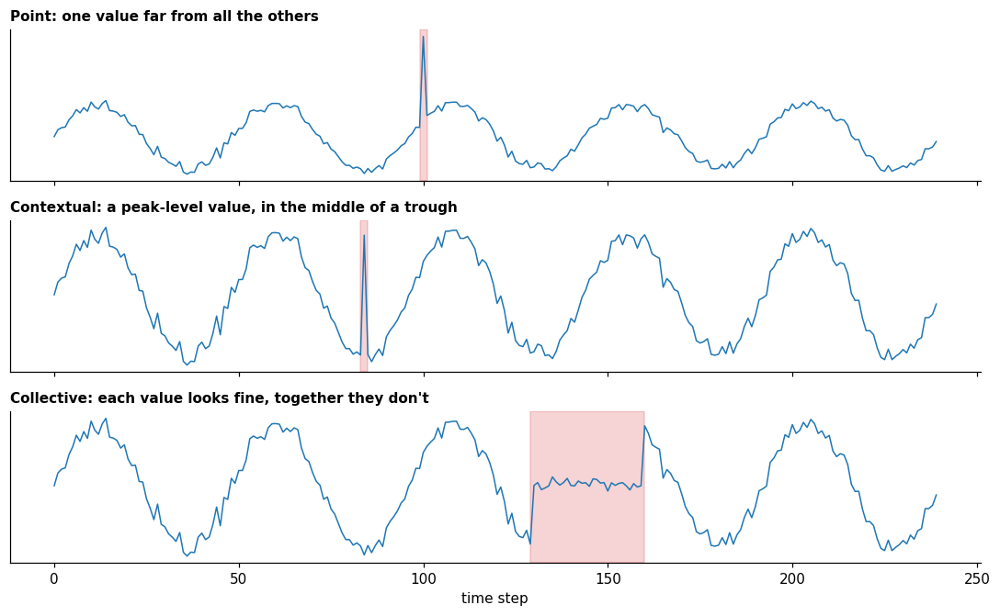

# Anomaly detection

**In one sentence:** anomaly detection flags the steps, or stretches, of a series that don't behave as normal.

- **Builds on:**
  - [Precision, recall and F1](../../evaluation/precision-recall-f1.md)
  - [AUROC](../../evaluation/auroc.md)
  - [AUPRC](../../evaluation/auprc.md)
  - [Patterns](../structure/patterns.md)
  - [Tasks](tasks.md)
- **Used by:**
  - [Windows](../data-preparation/windows.md)
  - [Splitting](../data-preparation/splitting.md)
  - [Point adjustment](../evaluation/point-adjustment.md)
  - [VUS](../evaluation/vus.md)
  - [Drift in time series](../change-over-time/drift-in-time-series.md)

## The task

**Purpose:** "identifying unusual or abnormal patterns within a time series, which can indicate critical events, system faults, or outliers" ([wang2026deep](../../../literature/wang2026deep.md), p. 3).

In general, anomalies are observations that "deviate significantly from the majority of the data" and "do not conform to a well defined notion of normal behavior" ([Anomaly detection][anomaly]).

**Examples:** industrial maintenance ([wang2026deep](../../../literature/wang2026deep.md)); a water-treatment plant under attack; server failures; fraud.

**Input and output:**

- **given:** a series;
- **produce:** an **anomaly score** for each step, then a decision, normal or anomalous, by comparing the score with a **threshold**.

### Kinds of anomalies

A survey of deep anomaly detection distinguishes three kinds ([pang2021deep](../../../literature/pang2021deep.md), p. 4):

| Kind | What it is | Example |
|---|---|---|
| **Point** | a single value far from the rest | a sensor suddenly reading ten times its usual value |
| **Contextual** (conditional) | a single value that is normal in general, but not at that moment, e.g. a "sudden temperature drop/increase in a particular temporal context" | heating at full power on a summer afternoon |
| **Collective** (group) | a stretch that is abnormal as a whole, even if each value alone looks normal | a machine's regular rhythm stopping for an hour |

### Labels: usually there are none

Anomalies are rare, and labeled anomaly data are hard or impossible to collect at scale ([pang2021deep](../../../literature/pang2021deep.md), p. 4). So most methods learn **what normal looks like**, then flag what doesn't fit.

Three settings, as Wikipedia describes them ([Anomaly detection][anomaly]):

| Setting | Training data | How often it's used |
|---|---|---|
| **Unsupervised** | unlabeled data | "by far the most commonly used" |
| **Semi-supervised** | some labeled data; more often than not, data known to be normal, from which a model of "normal behavior" is built | not stated |
| **Supervised** | data labeled normal and abnormal | "rarely used", because labels are unavailable |

pang2021deep adds a fourth, **weakly supervised**: some anomaly labels, but partial, inexact or inaccurate ([pang2021deep](../../../literature/pang2021deep.md), p. 5).

**The names clash.** pang2021deep calls training on normal data only "semi-supervised", and notes that it is sometimes called unsupervised elsewhere ([pang2021deep](../../../literature/pang2021deep.md), p. 5, footnote 1).

Time-series work may use "unsupervised" instead: the TSLib survey, for one, calls reconstruction "a classical task for unsupervised point-wise representation learning" ([wang2026deep](../../../literature/wang2026deep.md), p. 12).

### How it's judged

By comparing the flagged steps with the true anomalies:

- **precision, recall and F1** once a threshold is set ([precision, recall and F1](../../evaluation/precision-recall-f1.md));
- threshold-free measures such as [AUROC](../../evaluation/auroc.md) and [AUPRC](../../evaluation/auprc.md);
- and measures adapted to anomalies that last several steps ([point adjustment](../evaluation/point-adjustment.md), [VUS](../evaluation/vus.md)).

The TSLib benchmark reports F1, "a balanced combination of precision and recall" ([wang2026deep](../../../literature/wang2026deep.md), p. 11); its overview figure lists both accuracy and F1 for anomaly detection (Figure 8, p. 10).

**What makes it hard:**

- **The threshold decides everything.**
  - A low threshold catches more anomalies but raises false alarms; a high one does the opposite.
  - Some papers don't state how they choose it: TimesNet and the TSLib survey both leave the threshold rule out ([wu2023timesnet](../../../literature/wu2023timesnet.md), pp. 8, 13, 22; [wang2026deep](../../../literature/wang2026deep.md), p. 12).
- **False alarms:** methods "still often incur high false positives on real-world datasets" ([pang2021deep](../../../literature/pang2021deep.md), p. 4).
- **"Normal" can change over time.** If the series drifts, behavior that was abnormal may become normal, and the other way round ([drift in time series](../change-over-time/drift-in-time-series.md)).

## Key points

- **Given** a series, **produce** an anomaly score per step, then normal or abnormal via a **threshold**.
- Anomalies can be **point**, **contextual** or **collective**.
- Labels are usually missing: most methods learn what normal looks like.
- Judged by **precision, recall and F1**, or threshold-free measures.

## Sources

- [wang2026deep](../../../literature/wang2026deep.md): definition, examples, benchmark metric, the unstated anomaly threshold.
- [pang2021deep](../../../literature/pang2021deep.md): kinds of anomalies, rarity of labels, the weakly supervised setting and its naming of the semi-supervised one, false positives.
- [wu2023timesnet](../../../literature/wu2023timesnet.md): the unstated anomaly threshold.
- [Anomaly detection (Wikipedia)][anomaly]: general definition, labeling settings. Read on 2026-11-08.

[anomaly]: https://en.wikipedia.org/wiki/Anomaly_detection
