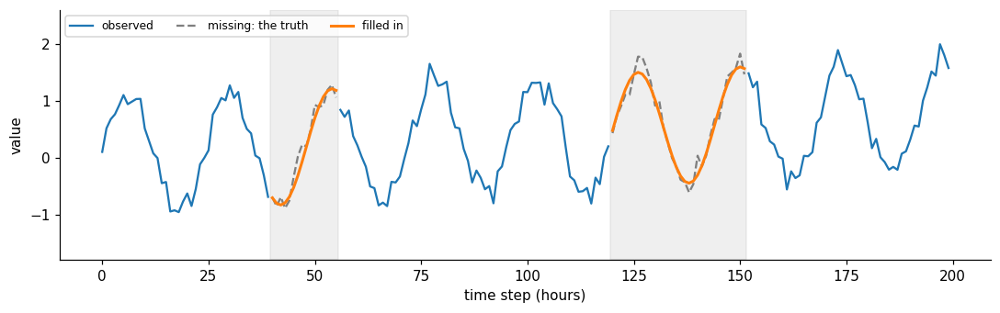

# Imputation

**In one sentence:** imputation fills the gaps of a series with estimates of the missing values.

- **Builds on:** [Regression errors](../../evaluation/regression-errors.md), [Tasks](tasks.md).
- **Used by:** the [method](../../../method/README.md).

## The task

**Purpose:** imputation "focuses on reconstructing missing values using the available contextual information" ([wang2026deep](../../../literature/wang2026deep.md), p. 3).

More generally, "imputation is the process of replacing missing data with substituted values" ([Imputation][imputation]).

**Examples:** sensor dropouts, lost transmissions, a broken meter for a few hours.

**Input and output:**

- **given:** a series where some values are missing;
- **produce:** estimates for the missing values.

Unlike forecasting, the model can usually use what comes **both before and after** a gap.

The shaded stretches are missing. The model fills them in using the values on both sides; the dashed line is the truth, which the model never sees.

**How it's judged:** in benchmarks:

- values are hidden on purpose from a complete series: in the TSLib (Time-Series-Library) benchmark, time points are masked at random, with ratios of 12.5%, 25%, 37.5% and 50% ([wang2026deep](../../../literature/wang2026deep.md), p. 12),
- then the estimates are compared with the hidden truth, with MSE (mean squared error) and MAE ([regression errors](../../evaluation/regression-errors.md); [wang2026deep](../../../literature/wang2026deep.md), p. 11).

**What makes it hard:** long gaps, and gaps that aren't random (a sensor that fails exactly when conditions are extreme).

## Key points

- **Given** a series with gaps, **produce** the missing values, using what comes both before and after a gap.
- Judged by hiding known values on purpose and comparing the estimates with them (MSE, MAE).

## Sources

- [wang2026deep](../../../literature/wang2026deep.md): definition, benchmark protocol and masking ratios.
- [Imputation (Wikipedia)][imputation]: general definition. Read on 2026-11-08.

[imputation]: https://en.wikipedia.org/wiki/Imputation_(statistics)
