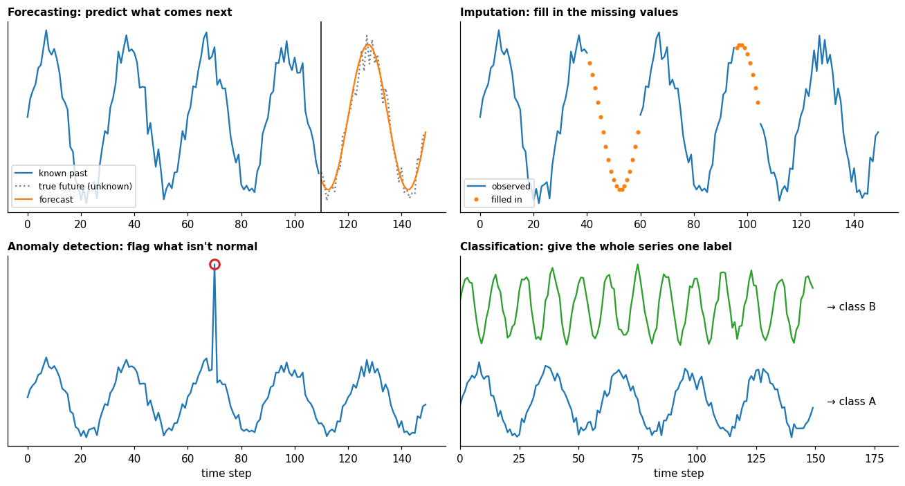

# Tasks

**In one sentence:** the same time series can be asked four different questions (what comes next, what's missing, what's abnormal, what kind is it), and each question is a different task with its own purpose, inputs, outputs and way of being judged.

- **Builds on:** [Time series](../time-series.md), [Patterns](../structure/patterns.md).
- **Used by:**
  - [Forecasting](forecasting.md)
  - [Imputation](imputation.md)
  - [Anomaly detection in time series](anomaly-detection.md)
  - [Classification](classification.md)
  - [Windows](../data-preparation/windows.md)
  - [Datasets](../datasets/README.md)

## The four tasks at a glance

A survey of deep time-series models groups the main tasks into four ([wang2026deep](../../../literature/wang2026deep.md), p. 3):

| Task | The question | Given | Produce |
|---|---|---|---|
| **Forecasting** | what comes next? | the past | the future values |
| **Imputation** | what's missing? | a series with gaps | the missing values |
| **Anomaly detection** | is something abnormal? | a series | which steps (or stretches) are abnormal |
| **Classification** | what kind of series is this? | a whole series | one label |

Each has its own doc: [forecasting](forecasting.md), [imputation](imputation.md), [anomaly detection](anomaly-detection.md) and [classification](classification.md).

## One family

The TSLib benchmark treats the tasks as one problem: it unifies them "as a representation learning task with domain-specific heads", a backbone shared across tasks with a small task-specific part on top ([wang2026deep](../../../literature/wang2026deep.md), p. 11).

Not every model is evaluated on every task, though: TiDE, which needs timestamps, is tested on long-term forecasting only ([wang2026deep](../../../literature/wang2026deep.md), p. 13).

One way to see why a shared backbone can work: the four tasks look different, but each draws on the same skill, **understanding how the series normally behaves**.

- **Forecasting** uses it to continue the series.
- **Imputation** uses it to fill the series in.
- **Anomaly detection** uses it to measure how far the data are from normal.
- **Classification** uses it to tell kinds of behavior apart.

The data are prepared in a similar way too: [windows](../data-preparation/windows.md) describes one common way, with small differences per task.

## Key points

- **Forecasting:** past → future values. **Imputation:** a series with gaps → the missing values.
- **Anomaly detection:** series → normal or abnormal, step by step. **Classification:** whole series → one label.
- The TSLib benchmark treats all four as one representation-learning problem: a shared backbone with task-specific heads.
- One way to see the link: all four draw on modeling **normal behavior**.

## Sources

- [wang2026deep](../../../literature/wang2026deep.md): the four tasks, and the benchmark's shared backbone with task-specific heads.
