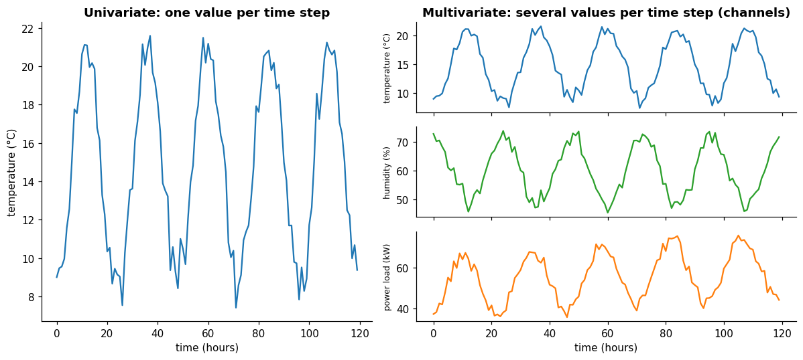
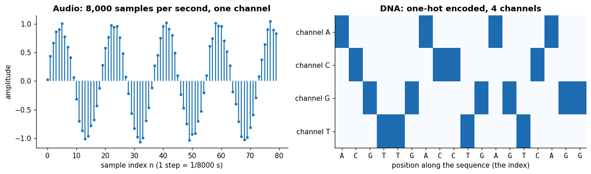

# Time series

**In one sentence:** a time series is a signal recorded as a list of values in time order, usually at equal intervals, and many kinds of data can be read as one.

- **Builds on:** [Signals](../signals/signals.md), [Sampling](../signals/sampling.md).
- **Used by:**
  - [Patterns](structure/patterns.md)
  - [Tasks](tasks/tasks.md)
  - [Windows](data-preparation/windows.md)
  - [Splitting](data-preparation/splitting.md)
  - [Normalization in time series](data-preparation/normalization.md)
  - [Tokens and patching](models/tokens-and-patching.md)
  - [Datasets](datasets/README.md)

## What a time series is

A time series is "a sequence of data points indexed, listed, or graphed in chronological order"; "most commonly, a time series consists of observations recorded at successive equally spaced points in time" ([Time series][ts]).

Connecting it to [signals](../signals/signals.md) and [sampling](../signals/sampling.md):

- a time series is a **sampled, time-based signal**: "it represents a form of discrete-time data" ([Time series][ts]);
- the two names often mean the same thing: "discrete-time signals are often referred to as time series in other fields" ([Signal][signal]).

A series of length $T$ is written

$$x_1, x_2, x_3, \dots, x_T$$

where $x_t$ is the value at step $t$. The steps are usually equally spaced: every second, every hour, every day. Common examples are "heights of ocean tides, counts of sunspots, daily temperature readings" ([Time series][ts]).

## What makes a time series special

A table of data where each row is a separate person, product or patient has no natural order: shuffling the rows changes nothing.

An image is in between. Its pixels are ordered by **position**: a digital image "contains a fixed number of rows and columns of pixels" ([Digital image][image]), so shuffling them destroys the picture. But position has no past and future: every pixel is available at once ([time-based vs not time-based](../signals/signals.md#time-based-vs-not-time-based)).

A time series is ordered too, but in **time**. "Time series data have a natural temporal ordering", which distinguishes it from "cross-sectional studies, in which there is no natural ordering of the observations" ([Time series][ts]).

Three consequences follow, and they matter for everything later:

1. **Order carries information.** A value only makes sense next to its neighbors: is it rising, falling, repeating? Shuffle the steps and the pattern is gone.
2. **Neighboring values are related.** The temperature at 10:00 says a lot about the temperature at 11:00. Steps are not independent samples, and methods that assume independent samples need care.
3. **The future is unknown.** As for every [time-based signal](../signals/signals.md#time-based-vs-not-time-based): while a series is being recorded, only the past is available.
   - A model that predicts what comes next must never peek ahead: it must be causal.
   - Tasks that don't predict what comes next, such as filling a gap or judging a stretch after the fact, may legitimately use values on both sides.

## Univariate and multivariate

How many values are recorded at each step?

| | Univariate | Multivariate |
|---|---|---|
| **At each step** | one value | several values, one per **channel** (also called variable, variate or **feature**) |
| **Written** | $x_t \in \mathbb{R}$ | $\mathbf{x}_t \in \mathbb{R}^{C}$, with $C$ channels |
| **The whole series** | a list of $T$ numbers | a table of $T$ rows and $C$ columns ($T \times C$) |
| **Example** | a room's temperature every hour | temperature, humidity and power load of a building, every hour |

In a multivariate series all channels **share the same clock**: row $t$ holds every channel's value at the same moment.

The channels often influence each other (the power load follows the temperature), and that relation is information a model can use.

In machine learning, each channel is a **feature**: "an individual measurable property or characteristic of a data set" ([Feature][feature]). The temperature, the humidity and the power load are three features of the same series.

Real benchmark datasets range from a handful of channels to hundreds. These counts come from the TimesNet paper's dataset table ([wu2023timesnet](../../literature/wu2023timesnet.md), Table 6, p. 14); the domains are described in words, from the paper's text and Table 6:

| Dataset | Domain | Channels $C$ | Sampled every |
|---|---|---|---|
| ETTh1, ETTh2 | electricity | 7 | hour |
| Exchange | currency exchange rates | 8 | day |
| Weather | weather station | 21 | 10 minutes |
| PSM (Pooled Server Metrics) | server machines | 25 | (not stated) |
| SWaT (Secure Water Treatment) | a water-treatment plant | 51 | (not stated) |
| Electricity | electricity | 321 | hour |
| Traffic | transportation | 862 | hour |

(The TimesNet paper's table labels ETTh1 and ETTh2 as "15 mins", while its text calls them hourly; the [note on the paper](../../literature/wu2023timesnet.md) records the mismatch.)

## Many things can be treated as time series

The same idea, an ordered list of values, with one or more channels, fits a surprising range of data.

Strictly, a time series is ordered by time. DNA (deoxyribonucleic acid), text and images are not: they are **ordered sequences** that borrow time-series tools, because the same tools work on any ordered list.

| Data | The index $t$ is… | Channels | Values |
|---|---|---|---|
| **Audio** | time, 44,100 steps per second for CD (compact disc) sound ([Sampling][sampling]) | 1 (mono), 2 (stereo) | air pressure |
| **Heartbeat (ECG, electrocardiogram)** | time | one per electrode | voltage |
| **Industrial plant** | time | one per sensor or actuator (51 for SWaT, table above) | flows, levels, on/off states |
| **Stock price** | time (each trading day or minute) | 1 per stock, or several (open, high, low, close) | prices |
| **DNA** | **position** in the sequence | 4 after encoding (A, C, G, T) | 0 or 1 |
| **Text** | position of each word or character | one per symbol, after encoding | 0 or 1 |
| **Image** | **position**, with two indexes: row and column | 3 for a color image (red, green, blue), 1 for grayscale ([Channel][channel]) | brightness |
| **Video** | time, one step per frame | one per pixel and color | brightness |

Two examples from the figure:

- **Audio** is already a time series: sampled sound is one number per step, 8,000 steps per second in the figure, the rate used for telephone speech; music is usually recorded at 44,100 or more ([Sampling][sampling]).
- **DNA** isn't measured in time, but its letters come in a fixed order.
  - To turn letters into numbers, each position gets 4 channels, one per letter, set to 1 for the letter that's there and 0 for the others.
  - This is called **one-hot encoding**.
  - The result is a 4-channel series indexed by position.

**What changes when the index isn't time:** a DNA sequence or an image has an order but no past and future. Every position is known at once, so a model may look both ways. An image also needs two indexes, row and column, where a series has one.

The tools carry over; the rule "never use the future" only applies when the index really is time and the task is to predict what comes next.

## What the values can be

"Time series analysis can be applied to real-valued, continuous data, discrete numeric data, or discrete symbolic data" ([Time series][ts]):

| Values | Example |
|---|---|
| **Real numbers** | a temperature, a price |
| **Counts** | visitors per hour, sunspots per month |
| **Symbols** | DNA letters, a machine's state (off / idle / running); usually turned into numbers by encoding, as above |

## Real series are messy

Two practical points, which later docs come back to:

- **Missing values:** sensors fail, transmissions get lost; a series can have gaps that must be filled or masked.
- **Irregular spacing:** some series aren't recorded at equal intervals (e.g. events logged when they happen). Most methods assume equal spacing, so such series are first resampled onto a regular grid.

## Key points

- A **time series** is a time-ordered list of values, usually equally spaced: a sampled, time-based signal.
- **Order matters**, neighbors are related, and a model that predicts what comes next must never use the future.
- **Univariate:** one value per step. **Multivariate:** several channels (in machine learning, **features**) sharing the same clock, a $T \times C$ table.
- **Many data types can be treated as time series:** audio, sensors, prices, and even DNA, text and images, ordered by position rather than time.
- Values can be **real numbers, counts or symbols**; symbols are encoded as numbers, e.g. one-hot.

## Sources

- [Time series (Wikipedia)][ts]: definition, equal spacing, temporal ordering, types of values. Read on 2026-11-08.
- [Signal (Wikipedia)][signal]: discrete-time signals as time series. Read on 2026-11-08.
- [Sampling (signal processing) (Wikipedia)][sampling]: audio sampling rates. Read on 2026-11-08; telephone rate read on 2026-11-09.
- [Digital image (Wikipedia)][image], [Channel (digital image) (Wikipedia)][channel]: pixels in rows and columns, color channels. Read on 2026-11-09.
- [Feature (machine learning) (Wikipedia)][feature]: channels as features. Read on 2026-11-09.
- [wu2023timesnet](../../literature/wu2023timesnet.md): channel counts and sampling intervals of benchmark datasets.

[ts]: https://en.wikipedia.org/wiki/Time_series
[signal]: https://en.wikipedia.org/wiki/Signal
[sampling]: https://en.wikipedia.org/wiki/Sampling_(signal_processing)
[image]: https://en.wikipedia.org/wiki/Digital_image
[channel]: https://en.wikipedia.org/wiki/Channel_(digital_image)
[feature]: https://en.wikipedia.org/wiki/Feature_(machine_learning)
